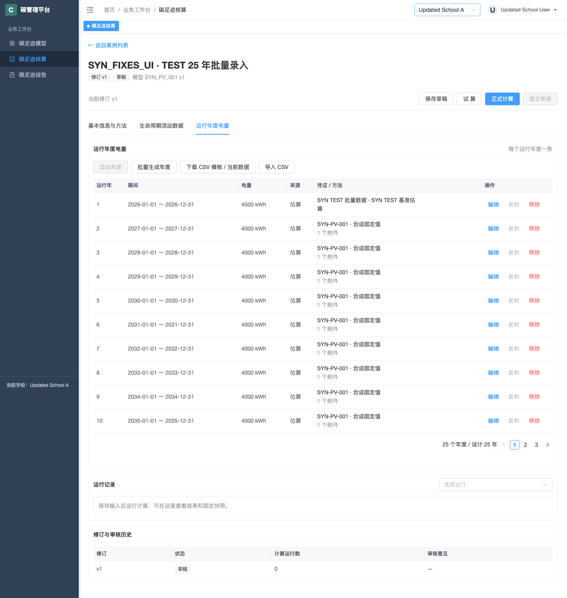
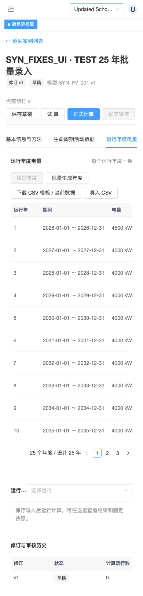
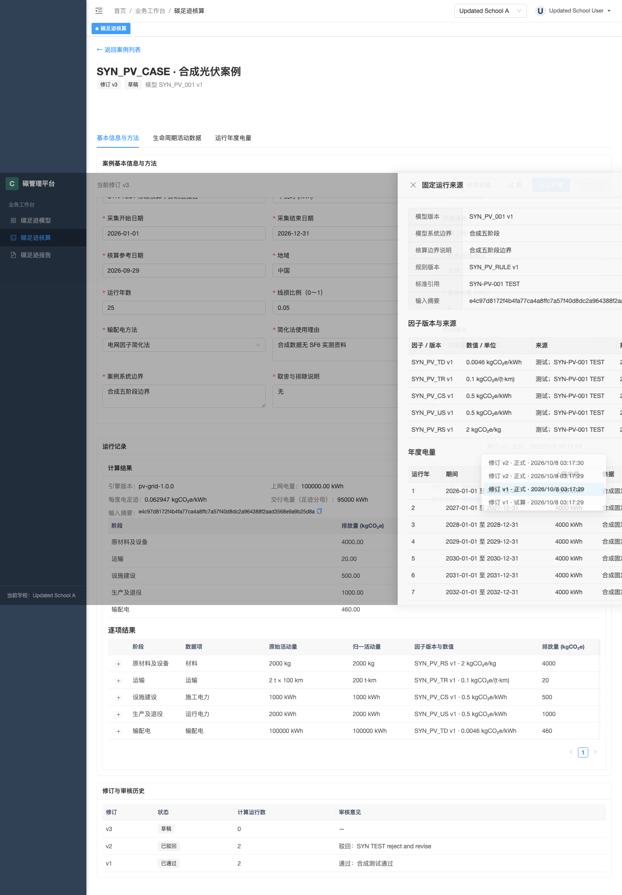

# 2026-10-08 全流程修复验收

已按复查顺序修复 F01～F09，并完成本机生产 Node 包、独立临时库迁移、容量和备份恢复演练。本记录使用合成数据，不表示真实业务签认或生产部署已经完成。原复现与证据保留在 [全流程复查记录](2026-10-07全流程复查记录.md)。

## 修复结果

| 顺序 | 项目 | 实现与验证 |
| --- | --- | --- |
| 1 | F01 规则发布 | 复用 `pvRuleSchema` 校验用途、方法、期间和确认依据；界面使用结构化字段。不完整内容、未知方法和倒置有效期发布返回 400，版本保持草稿。 |
| 2 | F03 核算错误页 | 无效 UUID、不存在及跨校案例返回 404，提供返回案例列表；不泄露其他学校内容。 |
| 3 | F02 单位与诊断 | 共享单位兼容维度供 UI 和内核复用；活动单位使用 Select，单位诊断定位 `.unit`。旧草稿中的“吨”在计算前被字段校验拦截，并自动切换到活动页签。 |
| 4 | F05 可读追溯 | 结果按五阶段顺序显示名称、原始/归一量与单位、因子版本及排放；只读面板展示固定模型、规则、因子、年度电量和证据。历史结果只使用各自快照。 |
| 5 | F04 年度录入 | 基本信息、活动与电量分区；年度分页表格、单年编辑、复制、批量补齐和 CSV 导入。已有年度和附件保留，CSV 覆盖前确认；计算校验全部年度。保存后保留当前页签，操作栏固定；证据显示文件名并可复用本校附件。 |
| 6 | F06 审核列表 | 编码/项目搜索、中文状态、更新时间排序和分页；审核角色默认待审核视图。详情状态、审核决定和历史已中文化。 |
| 7 | F07 报告模板 | 发布受控公共模板，在报告创建时选择；标题后缀与默认说明映射，数值/来源表不可配置。模板快照随报告固定并计入摘要，新版本不影响旧报告；篡改模板触发 409。 |
| 8 | F08 窄屏 | 顶栏收缩及表格局部滚动；390×844 下 body 和文档宽度均为 390，无页面级横向溢出。25 年电量页本次高度为 1614 像素。 |
| 9 | F09 PDF | 新版 `pv-report-1.0.2` 平衡长标题换行；样张标题两行分别为 17/18 字。六页中文、表头、追溯和数值已逐页目视检查。1.0.0/1.0.1 保留原版式及摘要兼容。 |

新增了 `/api/ready` 数据库就绪探针、连接池上限和超时、脱敏故障日志及请求编号、生产 Docker/Compose 配置、可执行私有备份与新库恢复、容量/恢复验证脚本和 [部署与运维手册](部署与运维手册.md)。

## 验证证据

- 38 项单元测试通过；类型检查、ESLint、格式与 Prisma schema 校验通过；生产 Webpack 构建通过。
- 阶段 3～7 全套独立库回归通过，覆盖身份、学校、角色、公用版本与模型审核、试算/正式核算、输入冲突、自审拦截、驳回修订、跨校权限、证据、报告编辑/独立审核、历史预览、并发 PDF 和摘要篡改。新增修复浏览器回归无控制台警告或错误。
- 本机容量：额外 500 个合成案例、20 并发、200 次请求；案例列表/详情、报告列表和缓存 PDF 下载全部成功，P50 108 ms、P95 148 ms、最大 206 ms，约 176.44 请求/秒，数据库连接峰值 11（含采样连接）。这是两校测试环境下的有限本机测量，不能外推生产规模或首次 PDF 渲染吞吐。
- 备份恢复：复用正式备份/恢复实现，生成 461223 字节自定义格式备份及 SHA-256 清单，恢复到独立新库；20 张表的行数和内容摘要一致，包括账号/会话、附件、快照、审计及 PDF 二进制；恢复后迁移可重复执行。演练库、服务和备份已自动清理。
- 本地开发库已先备份再应用增量迁移；原有 2 份报告、6 次修订和 2 个 PDF 的模板版本、正文摘要与文件字节保持不变。私有迁移前备份保留在本机临时目录，未放入交付证据。开发服务已重启加载最新结构；健康/就绪、已有演示账号登录、核算页面、旧模板预览及原 PDF 下载摘要复核均通过。
- Compose 配置语法检查通过；容器镜像拉取被本机 Docker DNS 故障阻断，未宣称容器构建或运行验收通过。

机器结果：[完整工程/容量/恢复摘要](acceptance/flow-fixes-20261008/release-result.json)、[修复回归摘要](acceptance/flow-fixes-20261008/workflow-fixes-result.json)、[本地迁移兼容检查](acceptance/flow-fixes-20261008/local-migration-result.json)、[开发服务及旧 PDF 复核](acceptance/flow-fixes-20261008/local-service-result.json)。

[六页公共模板与长标题 PDF 样张](../output/pdf/SYN_TEMPLATE_REPORT-v1.pdf)。各页渲染保存在同一证据目录的 `pdf-page-1.png` 至 `pdf-page-6.png`。

## 模块化与架构核对

遵守按职责拆分原则。核算页面复用现有基础方法、活动数据与未保存提醒，新增独立操作 Hook、固定操作栏、审核弹窗、历史表、业务诊断映射、模型行适配、结果追溯适配与快照面板。年度模块分成严格日期/CSV 函数、单年编辑、批量工具和分页组合；证据元数据缓存与上传选择器分开。列表筛选、表格与创建弹窗分别维护。

规则与报告模板分别抽出结构契约、表单转换和字段组件；报告复用既有来源、草稿、审核、摘要与渲染模块，只扩展模板快照。运维分为连接配置、故障日志、PostgreSQL 工具调用、私有备份/恢复、恢复指纹、容量验证和部署检查，集成入口负责组合。

仍有一个已知的历史混合职责文件：`scripts/stage3-smoke.mjs` 保留原有身份/管理/模型流程，尚未整体拆分。本轮新增修复、容量和恢复均在独立模块，未继续把这些业务实现堆入入口。后续改动旧管理/模型回归时可按领域迁出。根目录 `项目文件架构图.md` 已同步新增路径、用途和模块调用关系，并核对实际清单。

## 正式启用尚待外部条件

工程缺陷已修复；M5 本机工程演练通过。实际部署目标、域名/TLS、正式学校/用户/案例规模、首次 PDF 吞吐目标、备份 RPO/RTO、日志告警渠道和责任人尚未提供，需在目标环境完成容器构建、部署与回滚验收。B01～B06 方法、正式因子、真实手算案例和正式报告模板仍需业务签认；没有将合成数据当作签认材料。直供/混合供电、SF6 实测、风电/光热和 Word 继续按既有后续范围安排。
