# 碳管理平台使用说明书

版本 1.0　编写日期 2026 年 10 月 8 日

适用范围 当前工作区的并网光伏核算及报告流程

[下载可编辑 Word 版](../../output/docx/碳管理平台使用说明书.docx) · [下载 PDF 打印版](../../output/pdf/碳管理平台使用说明书.pdf)

## 章节目录

- [01 阅读说明](#01-阅读说明)
- [02 角色和操作权限](#02-角色和操作权限)
- [03 登录和进入学校工作台](#03-登录和进入学校工作台)
- [04 创建和维护学校](#04-创建和维护学校)
- [05 创建账号和维护学校归属](#05-创建账号和维护学校归属)
- [06 认识公共数据页面](#06-认识公共数据页面)
- [07 填写排放因子的数值和单位](#07-填写排放因子的数值和单位)
- [08 填写排放因子的适用范围](#08-填写排放因子的适用范围)
- [09 记录排放因子的来源和换算](#09-记录排放因子的来源和换算)
- [10 维护标准与公式配置](#10-维护标准与公式配置)
- [11 维护通用报告模板](#11-维护通用报告模板)
- [12 发布更新和停用公共数据](#12-发布更新和停用公共数据)
- [13 维护公用模型模板](#13-维护公用模型模板)
- [14 新建本校模型和引用模板](#14-新建本校模型和引用模板)
- [15 填写模型基本信息](#15-填写模型基本信息)
- [16 维护阶段大类和数据项](#16-维护阶段大类和数据项)
- [17 配置光伏计算映射并发布模型](#17-配置光伏计算映射并发布模型)
- [18 新建核算案例](#18-新建核算案例)
- [19 填写案例基本信息和方法](#19-填写案例基本信息和方法)
- [20 录入活动数据和选择公共因子](#20-录入活动数据和选择公共因子)
- [21 维护运行年度电量](#21-维护运行年度电量)
- [22 填写年度凭证和管理附件](#22-填写年度凭证和管理附件)
- [23 试算正式计算和查看结果](#23-试算正式计算和查看结果)
- [24 查看固定来源和历史运行](#24-查看固定来源和历史运行)
- [25 提交核算审核和处理驳回](#25-提交核算审核和处理驳回)
- [26 从已审核运行生成报告](#26-从已审核运行生成报告)
- [27 编辑报告正文和提交](#27-编辑报告正文和提交)
- [28 审核报告和创建新修订](#28-审核报告和创建新修订)
- [29 预览和导出已通过报告](#29-预览和导出已通过报告)
- [30 检查报告预览内容](#30-检查报告预览内容)
- [31 账号设置和审计追溯](#31-账号设置和审计追溯)
- [32 常见问题和交付前检查](#32-常见问题和交付前检查)

## 01 阅读说明

本说明书面向平台管理员和学校用户，说明如何维护公共资料、建立模型、完成并网光伏核算，并经独立审核生成 PDF 报告。按当前工作区 2026 年 10 月 8 日的功能与界面编写。

使用前请取得平台地址、登录账号和学校角色。学校业务按当前学校隔离；先核对页头显示的学校，再开展录入、审核或下载。

本书截图来自独立临时演示环境。带有 DEMO 或 TEST 的学校、项目、因子、凭证和报告均为构造资料；其中“正式”标签用于演示流程分支。实际操作应填写本项目经确认的资料，不直接照抄截图数值、日期或依据。

### 先理解四种资料的分工

| 资料 | 解决什么问题 | 使用位置 |
| --- | --- | --- |
| 公共数据 | 为多所学校提供版本化的因子、核算规则和报告默认内容 | 系统管理维护；核算和报告引用 |
| 公用模型模板 | 提供可复制的阶段、大类、数据项和计算映射 | 平台发布；学校复制为本校草稿 |
| 本校模型 | 定义本校要核算的结构及使用的模型版本 | 模型审核发布后用于新建案例 |
| 核算案例与报告 | 保存项目输入、计算结果、审核意见和历史修订 | 学校工作台维护与复核 |

操作顺序：平台准备学校、账号和公共资料 → 学校建立并发布模型 → 录入活动量与年度电量 → 正式计算并审核 → 生成、编辑、审核报告 → 导出 PDF。

平台管理员重点阅读第 04 至 13 节；模型维护者阅读第 14 至 17 节；核算员阅读第 18 至 27 节；审核员重点阅读第 02、25、28 节。第 29 至 32 节说明预览、历史、账号设置与常见问题。

## 02 角色和操作权限

账号在每所学校具有一个校内角色。按钮是否出现，取决于当前学校、角色及数据状态。平台管理权限与学校业务权限分别授权。

平台超级管理员维护学校、账号、学校归属、公共数据、公用模型模板和审计日志。只有取得学校成员身份后，才能进入相应学校的业务工作台。学校管理员当前不负责创建平台账号，新增账号或调整归属须由平台管理员办理。

模型、核算和报告实行独立审核：创建人、最后编辑人和提交人不能审核同一版本或修订，学校管理员也受此限制。需要至少另一位具备审核权限的成员参与。

### 校内操作权限

| 操作 | 学校管理员 | 模型维护者 | 核算员 | 审核员 | 只读用户 |
| --- | --- | --- | --- | --- | --- |
| 读取本校资料 | 可以 | 可以 | 可以 | 可以 | 可以 |
| 编辑并提交模型 | 可以 | 可以 | — | — | — |
| 审核发布本校模型 | 可以 | — | — | 可以 | — |
| 录入并提交核算 | 可以 | — | 可以 | — | — |
| 审核核算 | 可以 | — | — | 可以 | — |
| 创建并编辑报告 | 可以 | — | 可以 | — | — |
| 审核报告 | 可以 | — | — | 可以 | — |
| 导出已通过报告 | 可以 | — | 可以 | — | — |

### 首次使用前准备

1. 确认学校与账号均为启用状态，账号已分配正确学校及角色。
2. 准备已发布的本校光伏模型、适用的公共因子和规则版本。
3. 准备项目规格、地点、采集期间、系统边界、活动量、年度电量及相关凭证。
4. 安排录入人员与独立审核人员，明确资料交接方式。

## 03 登录和进入学校工作台

入口：打开管理员提供的平台地址，进入登录页。使用已分配的邮箱和密码登录。

图 1 登录页面的邮箱和密码入口

1. 输入登录邮箱和密码，点击“登录”。首次密码由平台管理员分配。
2. 学校成员登录后进入业务工作台；只有平台角色的账号进入系统管理。
3. 如账号属于多所学校，在页头学校选择框中选择本次操作的学校，核对“当前学校”和页头学校名称。
4. 通过左侧“碳足迹模型”“碳足迹核算”“碳足迹报告”进入相应业务。平台管理员从系统管理菜单进入管理页面。

成功标志：页头显示本人姓名和正确的学校，菜单与本人角色一致。登录失败时，先核对邮箱、密码和账号状态；忘记密码请联系平台管理员重置。

## 04 创建和维护学校

角色：平台超级管理员。入口：系统管理 → 学校与账号 → 按学校。

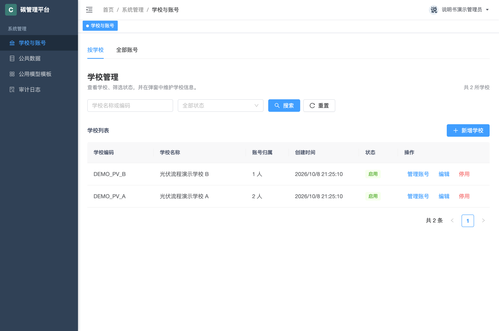

图 2 学校列表和新增学校入口

1. 点击“新增学校”，填写学校编码与名称后保存。编码用于唯一识别学校。
2. 建校后，页面引导为该校创建首位学校管理员；也可添加已有账号并赋予学校管理员角色。
3. 在学校列表点击“管理账号”，进入该校成员工作区。
4. 用名称、编码或状态筛选学校；点击“编辑”维护学校信息。
5. 点击“停用”并确认后，该校成员暂时无法访问学校业务；需要恢复时点击“启用”。

成功标志：学校出现在列表中，状态为“启用”，该校至少有一位可用的学校管理员。学校停用用于暂停访问，历史业务资料继续保留。

## 05 创建账号和维护学校归属

角色：平台超级管理员。入口：学校与账号 → 对应学校的管理账号；“全部账号”用于跨校查询与维护。

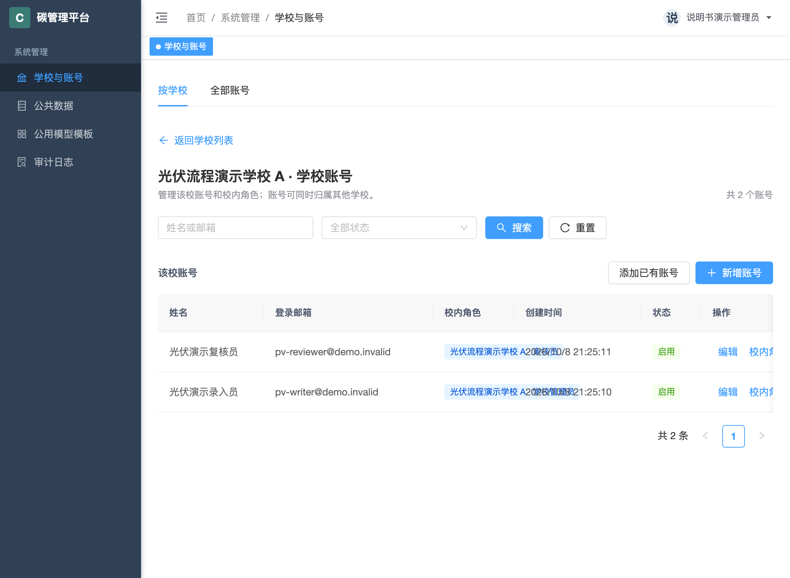

图 3 学校账号工作区和成员角色

1. 点击“新增账号”，填写姓名、登录邮箱、初始密码、所属学校和校内角色。初始密码至少 12 位。
2. 已有账号需要加入本校时，点击“添加已有账号”，选择账号并设置角色。一个账号可加入多所学校。
3. 通过账号的学校归属操作调整角色，或移除某所学校的归属；移除归属只影响该校访问。
4. 需要暂停登录时停用账号；忘记密码时执行重置密码，原登录会话失效。
5. 删除非平台管理员账号会撤销登录凭据及全部学校归属；匿名历史记录继续用于审计和追溯。平台管理员账号受到删除保护。

成功标志：成员列表显示正确邮箱、学校和角色标签。把初始密码交给对应使用人，并提醒其登录后在“账号设置”中修改。

## 06 认识公共数据页面

角色：平台超级管理员维护；学校用户在核算或报告中引用已发布资料。入口：系统管理 → 公共数据。

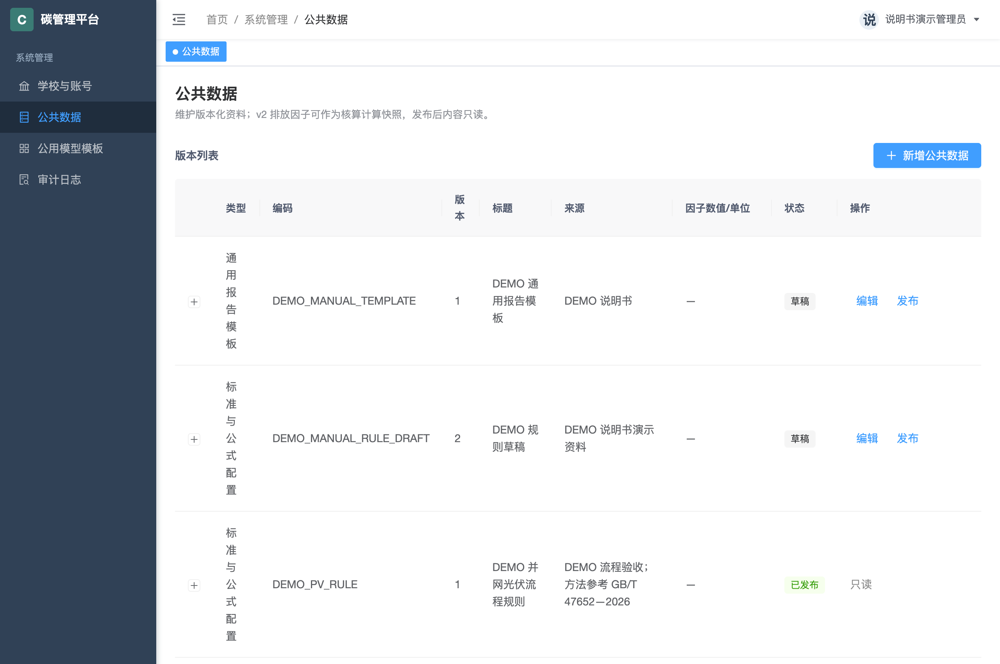

图 4 公共数据版本列表

公共数据是各学校共同使用的基础资料库。公共排放因子用于把活动量换算成排放量；标准与公式配置提供核算方法、引用依据和适用期；通用报告模板提供标题及默认说明。

1. 点击“新增公共数据”，选择类型，填写编码、版本、标题和来源。
2. 先保存草稿，再通过列表中的“编辑”补充资料；同一类型和编码下，版本标识不得重复。
3. 资料齐备后点击“发布”，在“校验并发布公共数据”弹窗中核对并确认。发布前系统会检查业务完整性。
4. 发布后该版本内容只读。学校的新核算和报告可引用符合条件的已发布版本。

模型内已有的数值因子可以直接用于试算。需要开展正式计算时，再为各数据项选择已发布的公共因子及规则版本。

## 07 填写排放因子的数值和单位

入口：公共数据 → 新增公共数据，类型选择“公共排放因子”；已保存草稿可点击“编辑”。

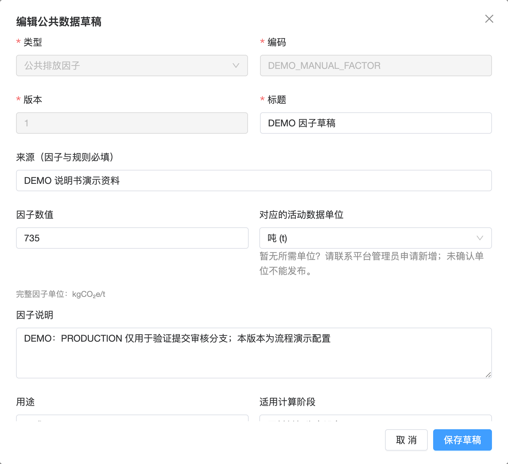

图 5 排放因子草稿中的数值与活动单位

1. 填写编码、版本、标题和来源，便于后续查找与版本追溯。
2. “因子数值”只填写数字；在“对应的活动数据单位”选择分母单位，例如吨或千瓦时。
3. 系统自动生成完整单位，分子统一为 kgCO₂e。不要把单位文字写进数值框。
4. 填写因子说明后保存草稿。缺少所需单位时联系平台管理员确认并安排维护单位目录。

核对重点：原资料数值与单位、录入数值与单位，以及换算过程应一致。截图中的数值只用于说明控件位置。

## 08 填写排放因子的适用范围

在因子弹窗内向下滚动，继续填写用途、计算阶段、适用对象、地域、技术与期间。

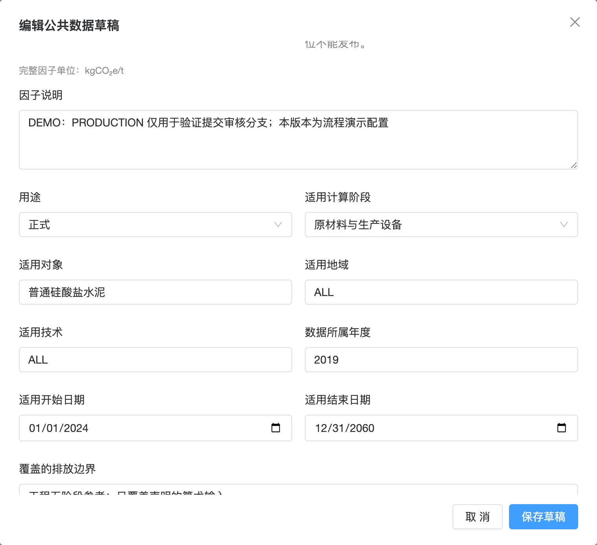

图 6 排放因子的用途和适用范围

1. 选择用途“测试”或“正式”，并选择因子实际适用的计算阶段。正式核算使用符合正式用途要求的版本。
2. “适用对象”填写对应的模型数据项名称；确有通用适用依据时才填写 ALL。地域和技术范围也应与资料一致。
3. 填写数据所属年度，以及适用开始和结束日期。有效期须覆盖实际引用的核算参考日期或活动日期。
4. 填写覆盖的排放边界，确认它与模型和案例的边界一致。

找不到因子选项时，先核对阶段、活动单位和适用对象；正式计算还会校验地域、技术和期间，必要时请管理员维护合适的因子版本。

## 09 记录排放因子的来源和换算

继续向下滚动，填写来源证据与版本依据。这些资料用于审核和后续追溯。

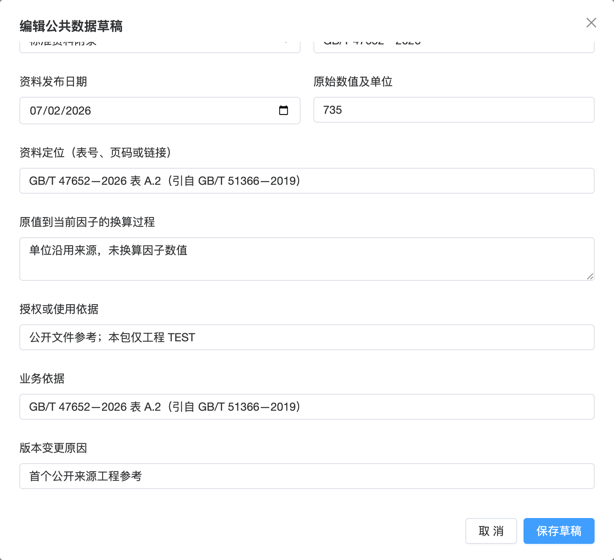

图 7 排放因子来源证据和版本依据

1. 选择来源类别，填写发布机构、资料发布日期和可定位的表号、页码或链接。
2. 填写“原始数值及单位”，说明从原值换算为当前因子数值的过程；无换算也明确说明原单位与当前单位一致。
3. 填写授权或使用依据、业务依据及版本变更原因。升级旧因子时，保留原文并逐项核对。
4. 保存草稿后返回版本列表，点击“发布”，补齐标红字段并执行“校验并发布”。

成功标志：列表状态为“已发布”，因子数值与完整单位显示正确。发布冻结该版本；后续修改应形成新版本。

## 10 维护标准与公式配置

入口：公共数据 → 新增公共数据 → 类型选择“标准与公式配置”。

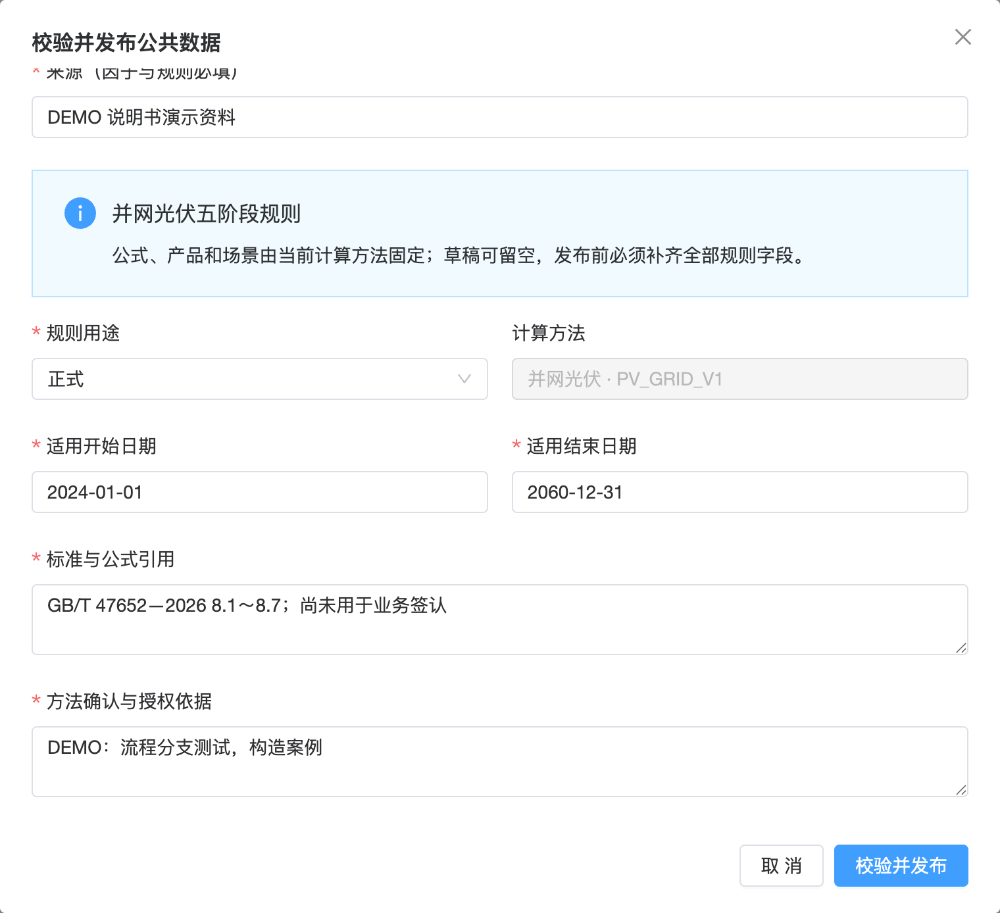

图 8 并网光伏规则的发布校验表单

1. 填写编码、版本、标题、来源和规则用途。
2. 核对计算方法。当前界面固定为“并网光伏 · PV_GRID_V1”，适用于当前并网光伏五阶段核算。
3. 填写适用开始日期、结束日期、标准与公式引用，以及方法确认与授权依据。日期使用 YYYY-MM-DD。
4. 保存草稿后点击“发布”，补齐所有必填规则字段并确认“校验并发布”。

成功标志：规则已发布，符合条件时可在核算案例“基本信息与方法”的“规则版本”中选择。实际方法依据由业务负责人确认后录入。

## 11 维护通用报告模板

入口：公共数据 → 新增公共数据 → 类型选择“通用报告模板”。

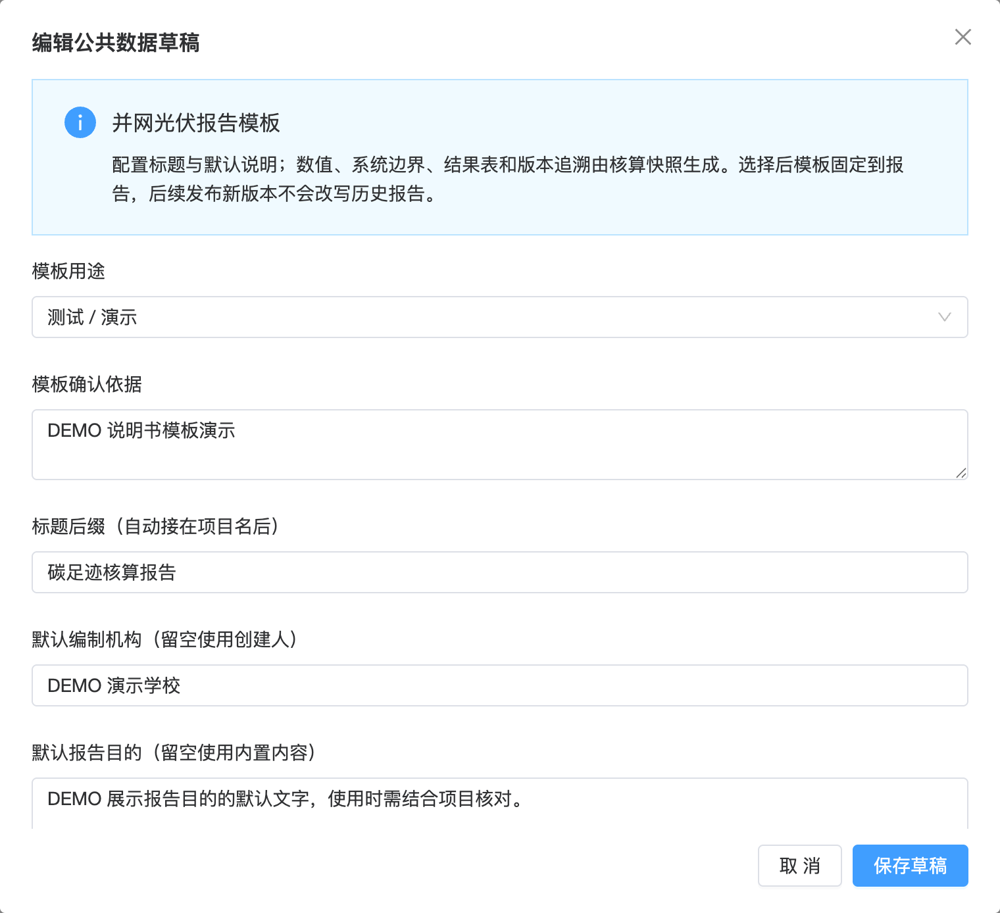

图 9 通用报告模板的标题和默认说明配置

1. 填写编码、版本和标题，选择模板用途，并填写模板确认依据。
2. 设置标题后缀，系统创建报告时将其接在项目名称后；默认编制机构留空时使用报告创建人。
3. 按需填写默认报告目的、核算方法、数据质量、结论、限制说明；留空的内容使用内置默认值。
4. 保存后发布。学校创建报告时可选择该模板，随后结合项目核对并编辑正文。

模板负责标题和默认说明。数值、系统边界、结果表与版本追溯由固定核算来源生成。选定的模板快照随报告保存，发布新模板不会改写旧报告。

## 12 发布更新和停用公共数据

公共数据通过版本区分不同发布内容。已发布版本保留原内容，后续更新采用新的版本标识。

### 更新一个已发布因子

| 状态 | 管理员可以做什么 | 学校使用方式 |
| --- | --- | --- |
| 草稿 | 编辑资料并进行发布校验 | 不进入学校的已发布版本选择 |
| 已发布 | 查看固定内容；因子可升级为新版本或停用 | 符合条件时用于新的核算或报告 |
| 因子已停用 | 查看历史资料和停用原因 | 不能用于新的正式计算或提交；历史运行继续保留 |

1. 在原因子行点击“升级为新版本”，保留原编码，输入尚未使用的新版本标识。
2. 核对复制来的数值、单位、适用期和来源，填写变更原因；旧版资料需要人工核对后补齐当前结构。
3. 保存草稿并发布新版本。新的核算主动选择新版本，旧运行继续引用原快照。
4. 因子不再适用时点击“停用”，填写原因并确认。停用不删除历史内容和审计记录。

规则或报告模板需要更新时，在“新增公共数据”中使用原编码和新的版本标识，录入并发布新内容。请在新案例开始前确认所需资料已发布且适用。

## 13 维护公用模型模板

角色：平台超级管理员。入口：系统管理 → 公用模型模板。公用模型模板提供可复制的模型结构。

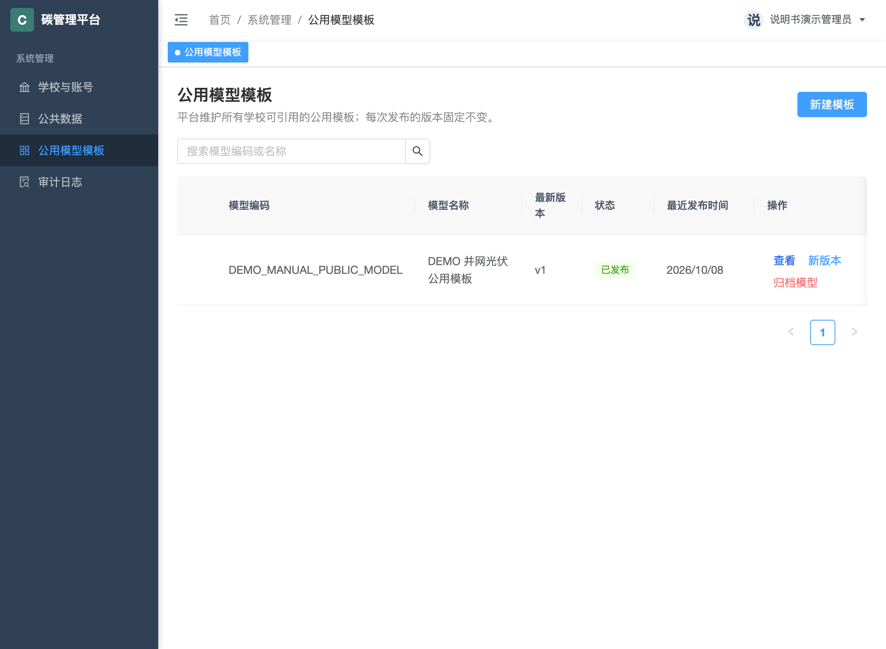

图 10 平台公用模型模板列表

1. 新建模板并填写编码，进入版本页面维护模型基本信息、生命周期阶段、大类、数据项与计算映射。
2. 先保存草稿；资料齐备后由平台管理员执行发布。发布前会校验必要的模型结构和单位。
3. 学校用户在“碳足迹模型”的公用模板列表中选择“引用模板”，复制指定已发布版本为本校草稿。
4. 公用模板需要修改时创建新版本。学校已复制的模型保留来源信息，自行维护和审核发布。

公用模型模板提供结构；公共因子和规则提供可引用的计算依据。两类资料共同参与学校核算，但各自独立管理版本。

## 14 新建本校模型和引用模板

角色：学校管理员或模型维护者。入口：学校工作台 → 碳足迹模型。

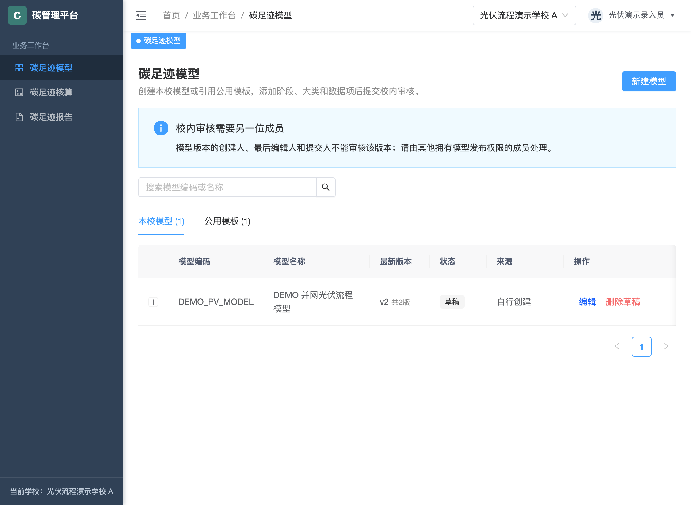

图 11 本校模型列表和公用模板入口

1. 新建本校模型时填写模型编码。编码使用 2 至 80 位字母、数字、下划线或连字符。
2. 可在创建弹窗选择已发布公用模板，也可在公用模板列表点击“引用模板”；不引用时创建空白模型。
3. 点击“创建草稿”后进入独立的模型版本页面，补充本校资料并保存。
4. 已发布模型需要更新时点击“新版本”，在新草稿中修改。历史已发布版本保留，旧案例继续使用原模型版本。

成功标志：本校列表出现新模型和草稿版本，编辑入口进入该版本页面。新建核算案例时只能选择已经发布的本校模型版本。

## 15 填写模型基本信息

在模型版本页面维护项目范围和功能单位。未完成的内容可先保存草稿，提交审核前需通过必填校验。

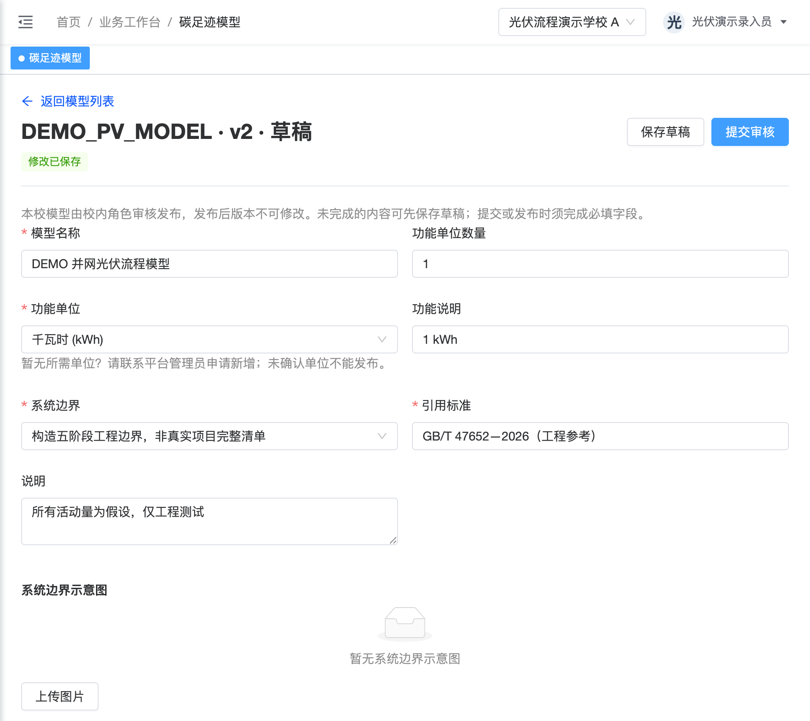

图 12 模型版本页面的基本信息表单

1. 填写模型名称、功能单位数量、功能单位和功能说明；功能单位数量应大于 0。
2. 选择或填写系统边界，补充引用标准与模型说明。按项目真实情况说明纳入的生命周期范围。
3. 按需上传系统边界示意图。当前支持不超过 2 MB 的 PNG、JPG 或 WebP。
4. 点击“保存草稿”。继续维护阶段、大类、数据项和光伏计算映射。

功能单位、活动数据单位均从现有单位目录选择。需要新增单位时联系平台管理员安排确认与维护。

## 16 维护阶段大类和数据项

在模型版本页面找到“生命周期阶段与数据项”，按核算结构逐层维护。

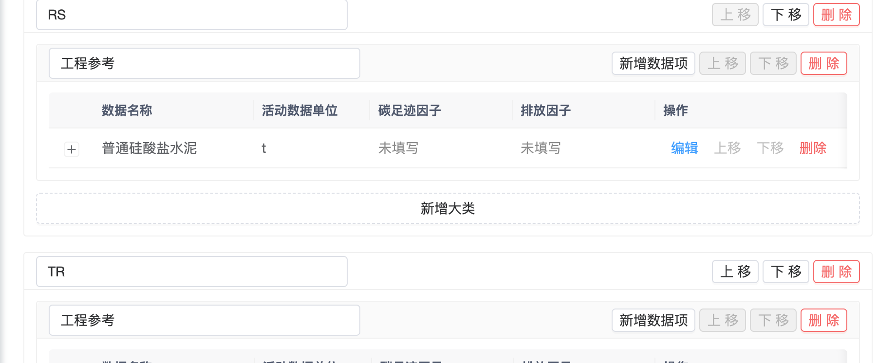

图 13 模型中的生命周期阶段与数据项

1. 点击“新增阶段”，填写阶段名称；在阶段下新增大类，再在大类下新增数据项。
2. 数据项填写名称、活动数据单位，并按需要填写规格型号、生产厂家、数据来源等资料。
3. “排放因子数值”是可选资料，只输入数字，单位随活动数据单位生成；该数值可供试算使用。
4. 用页面操作调整阶段、大类或数据项的顺序，核对全部结构后保存草稿。

正式核算时，模型数据项需要选择适用的公共因子版本。模型内数值因子目前不替代正式因子的完整适用范围、期间与来源资料。

## 17 配置光伏计算映射并发布模型

并网光伏核算需要把模型中的业务阶段对应到当前计算阶段。入口：模型版本页面 → 光伏计算映射。

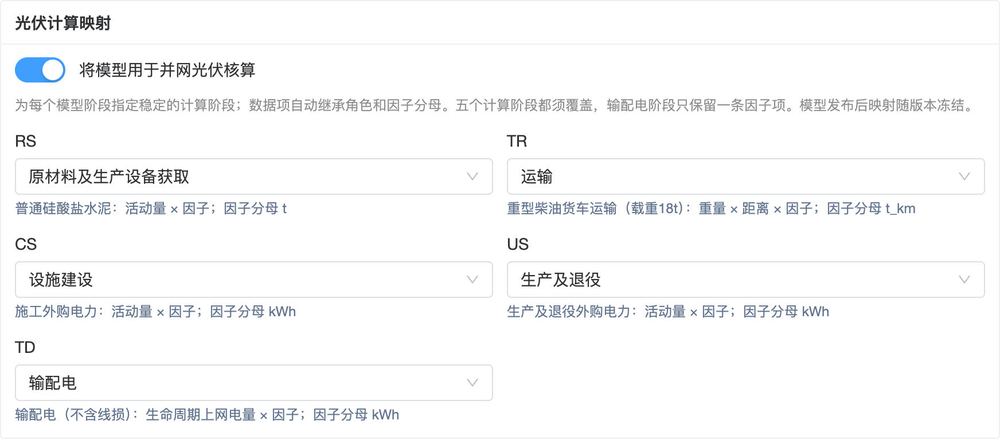

图 14 光伏五阶段计算映射

1. 打开“将模型用于并网光伏核算”，为每个模型阶段选择对应计算阶段。
2. 覆盖原材料及设备、运输、设施建设、生产及退役、输配电五个阶段；输配电阶段只保留一条因子项。
3. 核对数据项继承的计算角色：一般项目为活动量乘因子；运输为重量乘距离乘因子；输配电使用生命周期上网电量与因子。
4. 保存草稿，校内维护人员点击“提交审核”。独立审核人员核对资料后发布，或填写意见驳回。

成功标志：版本状态为“已发布”。创建人、最后编辑人、提交人不能审核该模型版本；已发布的结构和映射随版本冻结。

## 18 新建核算案例

角色：学校管理员或核算员。入口：学校工作台 → 碳足迹核算 → 新建案例。前提是本校已有已发布的光伏模型。

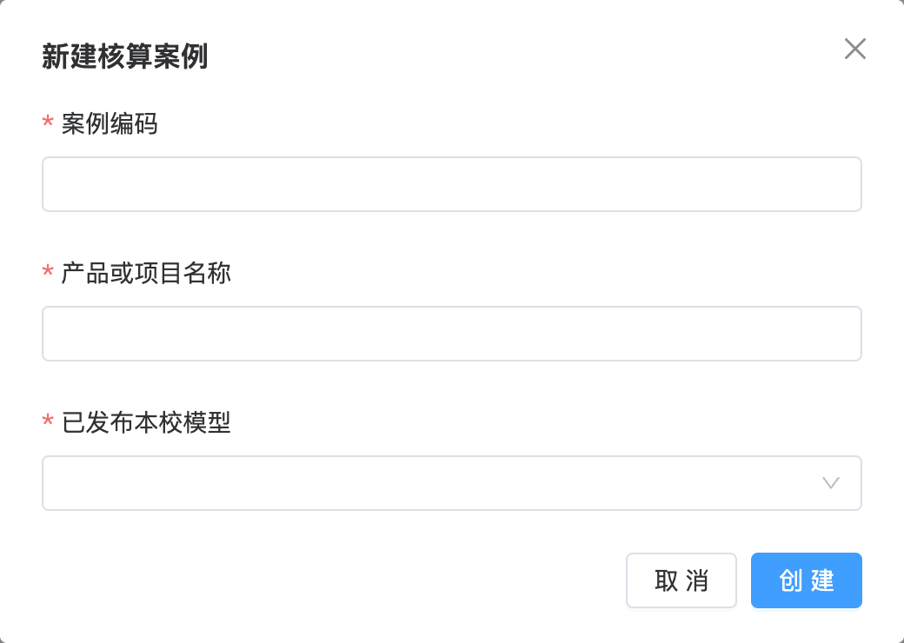

图 15 新建核算案例的模型版本选择

1. 填写案例编码和产品或项目名称。案例编码使用 2 至 80 位字母、数字、下划线或连字符。
2. 从“已发布本校模型”中选择正确版本，点击“创建”。
3. 进入案例详情后，按“基本信息与方法”“生命周期活动数据”“运行年度电量”三个页签录入。
4. 案例列表可按编码、项目名称或状态查询；审核人员可使用“待审核案例”筛选待办。

成功标志：案例处于“草稿”，显示修订编号和所用模型版本。无法选择模型时，先完成本校模型发布与光伏映射。

## 19 填写案例基本信息和方法

在“基本信息与方法”页签填写项目、期间、边界及方法，并选择适用规则版本。

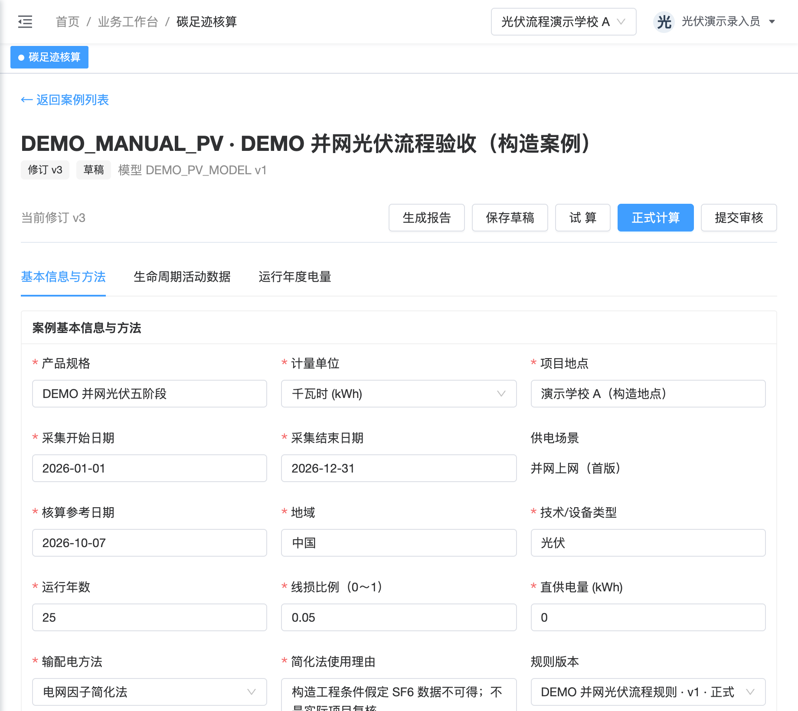

图 16 核算案例基本信息与方法页签

1. 填写产品规格、项目地点、采集开始与结束日期、核算参考日期、地域及技术设备类型。
2. 填写运行年数，确认年度电量会完整覆盖设计运行期；当前计量单位为 kWh，供电场景为并网上网。
3. 线损比例填写 0 至 1 的小数，例如 5% 填 0.05；并网场景的直供电量填写 0。
4. 选择电网因子简化法并说明使用理由，选择正式计算所需的规则版本。
5. 填写案例系统边界和取舍与排除说明；当前无排除项时填写“无”，再保存草稿。

当前界面显示的 SF₆ 实测法尚未启用；正式核算按已接入的并网光伏方法进行。日期与所选因子、规则的适用期间应一致。

## 20 录入活动数据和选择公共因子

进入“生命周期活动数据”页签，逐项记录实际活动量或明确说明不适用，并选择相应公共因子。

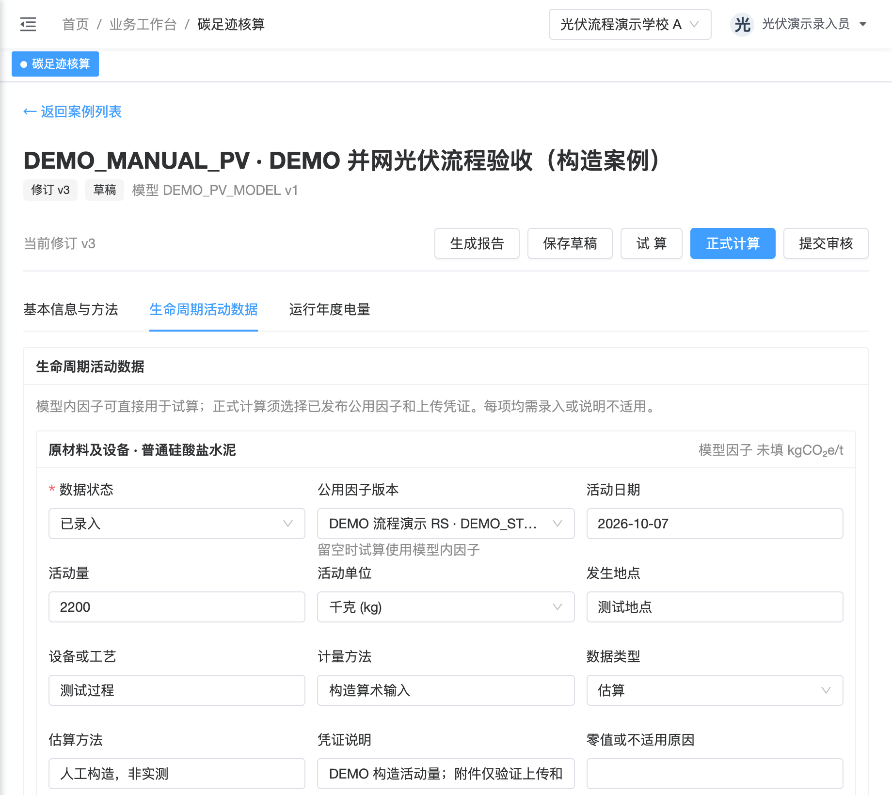

图 17 活动量录入和公用因子版本选择

1. 每项选择“已录入”或“不适用”。不适用时填写原因，不用空白代替说明；零值按页面要求说明原因。
2. 一般数据项填写活动量和活动单位；运输项填写重量、重量单位、距离及距离单位。
3. 填写活动日期、发生地点、设备或工艺、计量方法、数据类型；估算数据还需填写估算方法。
4. 正式计算为每项选择适用的“公用因子版本”。只做试算且模型已有数值因子时，可以留空使用模型内因子。
5. 填写凭证说明，并上传证据或复用本校已有证据。修改后保存草稿。

系统根据阶段、单位和适用对象筛选因子，并在计算时继续校验适用范围。列表没有所需版本时，联系平台管理员核对或发布资料。

## 21 维护运行年度电量

进入“运行年度电量”页签。年度表格分页展示，录入完整运行期的上网电量。

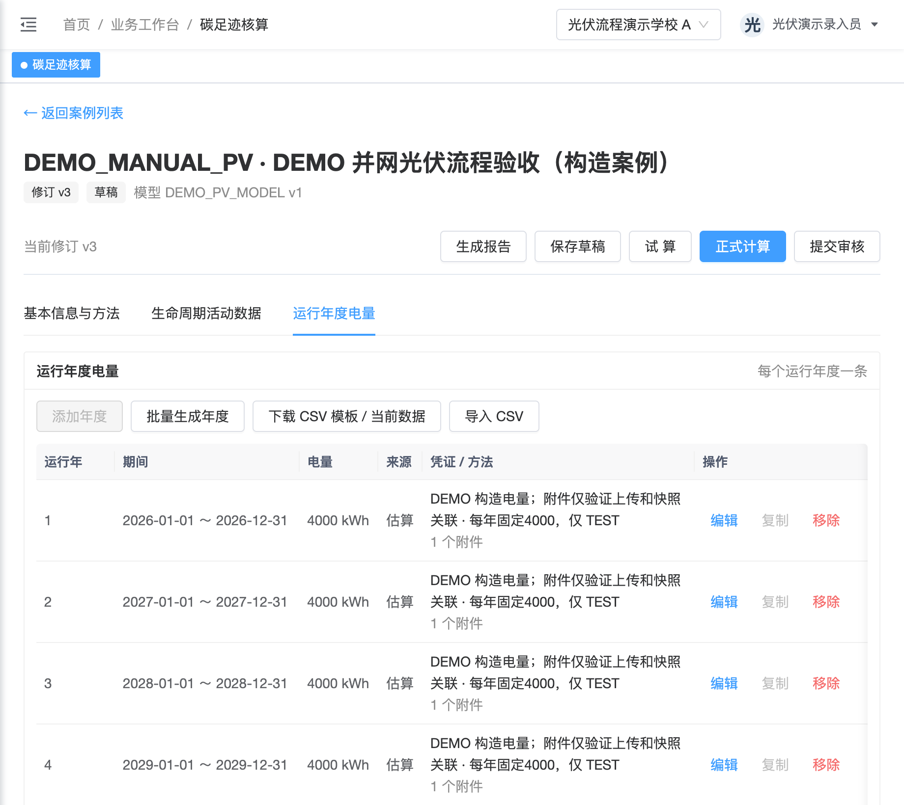

图 18 运行年度电量表格与批量工具

1. 点击“添加年度”，或在已有年度行点击“编辑”，填写年序号、完整期间、来源、电量和单位。
2. 需要快速补齐年度时点击“批量生成年度”，输入第 1 年起始日期、估算电量、依据和方法。已有年度保留，只补缺失年度。
3. 批量生成使用相同估算电量；请按实际衰减或测算结果调整各年，不能直接把默认生成值当作逐年实测值。
4. 可下载“CSV 模板 / 当前数据”，保持模板列名后填入逐年资料；通过“导入 CSV”核对变更并“应用导入”。
5. CSV 导入允许替换对应年度，并保留未导入年度和已有附件。核对汇总电量与年度数量后，点击案例的“保存草稿”。

CSV 大小不超过 500 KB。年度记录应覆盖 1 至运行年数，期间完整且不重复；正式计算还需关联有效凭证。

## 22 填写年度凭证和管理附件

年度弹窗中完成电量来源与证据信息。活动数据同样通过“上传证据”或“复用本校已有证据”关联资料。

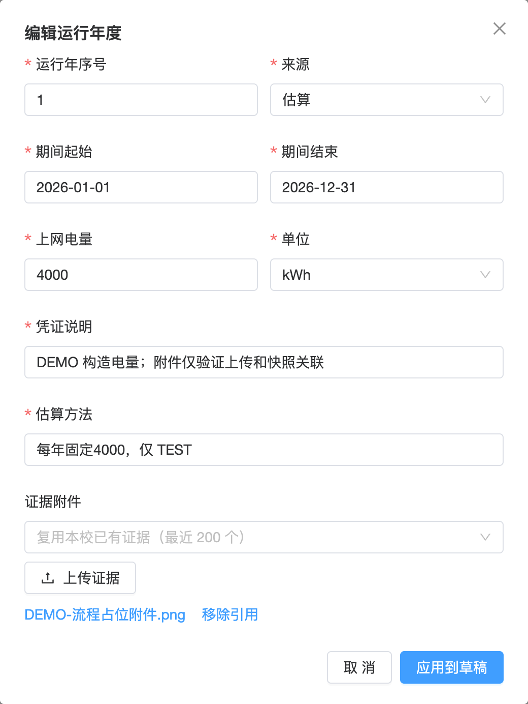

图 19 年度电量编辑与证据关联

1. 选择来源“实测”或“估算”，填写期间起始与结束、电量和单位。估算时填写估算方法。
2. 填写凭证说明，上传或关联支撑该年度的文件。每个证据文件可供本校多项活动或年度复用。
3. 证据支持不超过 5 MB 的 PDF、PNG、JPG 和 WebP，每项最多关联 20 个附件。点击文件名可查看或下载。
4. 点击“应用到草稿”只更新当前表单；还需在案例页面点击“保存草稿”保存年度修改和附件引用。

“移除引用”只移除该项对附件的关联。附件按学校授权读取；请在提交审核前核对文件内容和对应数据，截图中的占位附件仅用于演示。

## 23 试算正式计算和查看结果

完成输入后，先保存草稿，再按需要执行“试算”或“正式计算”。每次计算保存固定来源与结果。

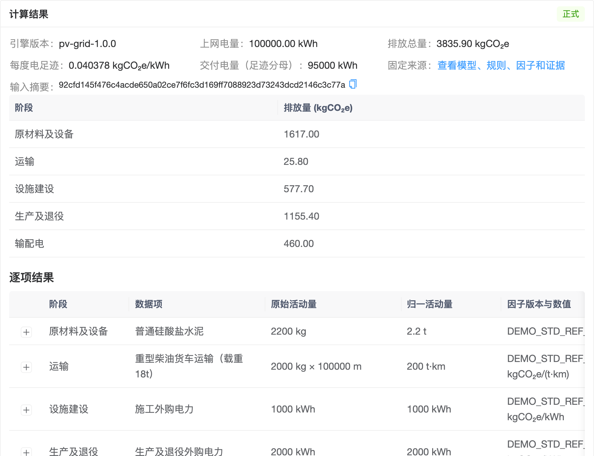

图 20 计算结果中的总量每度电足迹和阶段排放

1. 试算用于核对输入与计算结构。模型已有的数值因子可直接使用，也可选择公共因子；试算不能作为正式审核和报告来源。
2. 正式计算前选择已发布且适用的正式因子、规则版本，并补齐项目资料、活动数据、年度电量和凭证。
3. 点击“正式计算”，查看排放总量、上网电量、交付电量、每度电足迹、五阶段排放与逐项结果。
4. 修改输入后保存并重新计算。若显示“输入已变化，需重算”，不要提交旧结果。

成功标志：运行记录出现“正式”结果，且与当前已保存输入一致。错误提示会定位相关字段，先修正资料，再重新运行。

## 24 查看固定来源和历史运行

在计算结果的“固定来源”点击“查看模型、规则、因子和证据”，核对本次结果实际引用的版本。

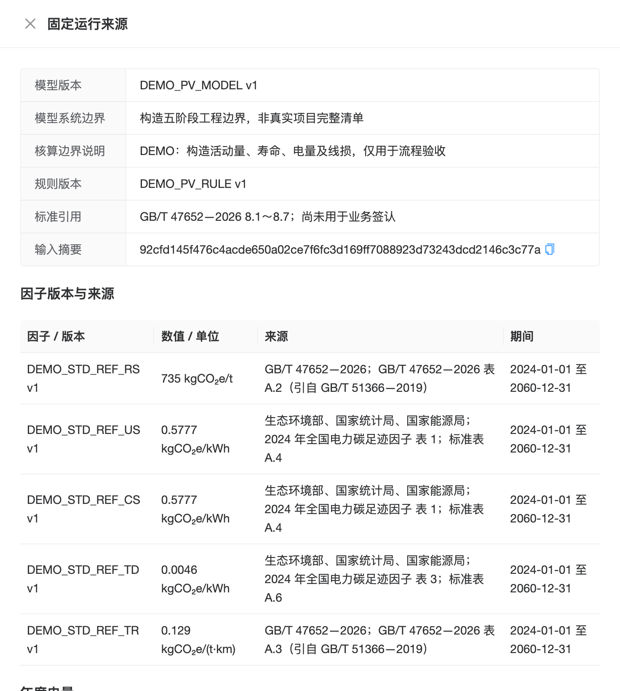

图 21 固定运行来源中的模型规则因子和证据

1. 查看固定模型版本、模型系统边界、案例边界、规则版本、标准引用和输入摘要。
2. 在因子来源表中核对因子编码、版本、数值、单位、适用范围与来源。
3. 查看本次运行关联的证据附件，确认它们支撑对应输入。
4. 使用案例中的“计算运行记录”选择不同修订的历史运行；根据“历史修订”“输入已变化”等标签判断当前查看的对象。

公共资料更新、案例新修订或重算后，旧运行仍保留当时的固定来源。审核与报告应引用明确的正式运行，而不是仅看当前表单。

## 25 提交核算审核和处理驳回

录入人员提交当前正式结果，另一位具备审核权限的成员审核。通过或驳回后，原修订和审核意见保留。

图 22 核算审核通过弹窗

1. 录入人员确认草稿已保存、正式计算对应当前输入后，点击“提交审核”。当前修订进入“待审核”，输入冻结。
2. 审核人员筛选待审核案例，检查输入、结果、固定来源和证据，点击“审核通过”或“驳回”。驳回必须填写原因。
3. 创建人、最后编辑人、提交人不能审核自己的修订；换由独立审核人员操作。
4. 被驳回或已通过后需要修改时，录入人员点击“创建新修订”，补充资料、保存、重新正式计算并提交。

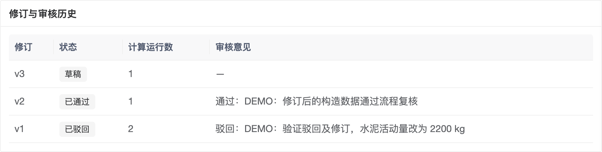

图 23 核算修订和审核历史

成功标志：修订显示“已通过”及审核意见；对应的正式运行可以生成报告。旧修订、运行和审核记录继续保留。

## 26 从已审核运行生成报告

角色：学校管理员或核算员。入口：已审核核算案例的“生成报告”，或学校工作台 → 碳足迹报告 → 生成报告。

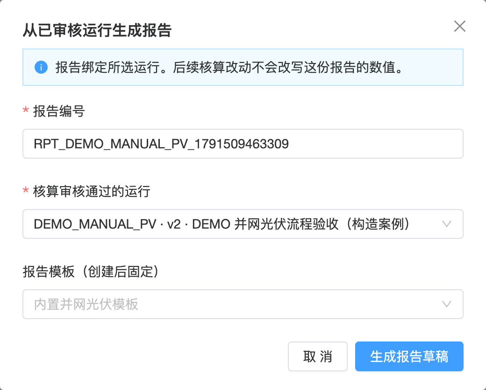

图 24 报告创建时选择固定核算来源和模板

1. 填写报告编号，选择核算审核通过的正式运行；从案例跳转时会带入相应运行。
2. 按需要选择已发布公共报告模板。留空时使用内置并网光伏模板，选择后固定到报告。
3. 创建报告后核对来源卡片中的案例修订、运行、排放结果、模型和规则版本。
4. 报告列表可按编号、标题、案例或状态查询，再进入“编辑 / 查看”。

成功标志：生成报告草稿，显示固定核算来源。没有可选运行时先完成正式核算审核；试算与未审核的正式计算不能生成报告。

## 27 编辑报告正文和提交

在“报告编辑”页签补充项目说明。报告的数值、系统边界和追溯表由固定来源生成。

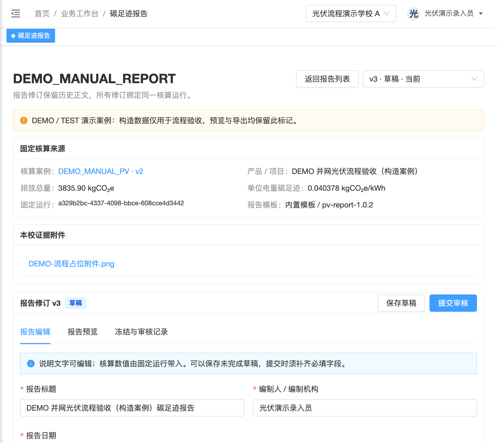

图 25 报告草稿的固定来源和编辑入口

1. 核对报告标题、编制人或机构、报告日期，并填写报告目的。
2. 补充核算方法与说明、数据质量与来源说明、结果分析与结论、限制与声明。模板默认文字须结合本项目核对。
3. 点击“保存草稿”，切换“报告预览”查看已保存的排版；未保存修改不会出现在预览中。
4. 正文各必填项齐全后点击“提交审核”。提交后正文冻结，等待独立审核。

报告正文调整不改变计算数值。需要改变活动量、因子或电量时，在核算案例创建新修订、重新计算并审核，再用新的已审核运行创建新报告。

## 28 审核报告和创建新修订

角色：学校管理员或审核员。录入和审核人员须相互独立，先核对固定核算来源，再审核说明文字与预览。

图 26 报告审核意见弹窗

1. 打开“待审核”的报告，核对来源案例、运行、数值、证据、正文和排版。
2. 点击“审核通过”或“驳回”，两种决定均须填写审核意见并确认。
3. 创建人、最后编辑人、提交人不能审核该修订，学校管理员同样受限。
4. 被驳回或已通过后需要修改正文时，录入人员点击“创建新修订”，修改、保存并再次提交。

同一报告的正文修订始终绑定同一核算运行；修订选择框可查看原审核意见及历史正文。核算来源发生变化时，需创建引用新运行的新报告。

## 29 预览和导出已通过报告

报告草稿保存后可以预览；导出 PDF 需要该修订已通过审核，且当前用户具有报告导出权限。

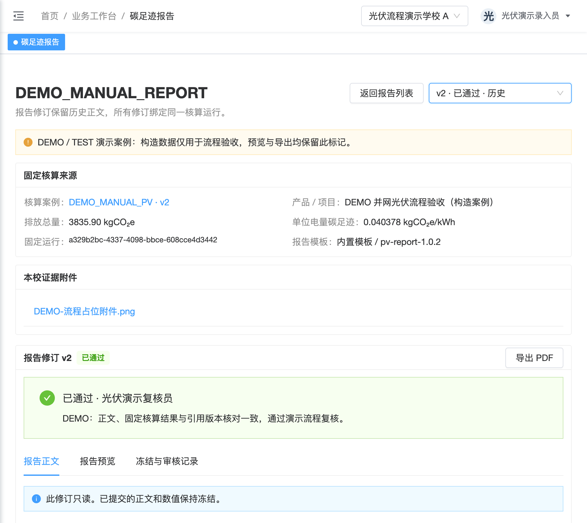

图 27 选择已通过历史修订并显示导出 PDF 入口

1. 在修订选择框选定需要查看或导出的版本，核对“当前”或“历史”标签及审核状态。
2. 切换“报告预览”检查标题、正文、结果表和追溯信息。预览使用该修订已保存的内容。
3. 已通过修订由学校管理员或核算员点击“导出 PDF”，待生成完成后下载。
4. 导出后核对报告编号、修订编号、日期与核算来源。历史已通过版本可继续下载。

看不到导出按钮时，先核对当前所选修订是否“已通过”，以及本人是否具有导出权限。截图中的 DEMO 报告在预览与导出中保留演示标记。

## 30 检查报告预览内容

报告预览提供与导出一致来源的中文排版。打印或交付前，请逐页核对项目文字和结果。

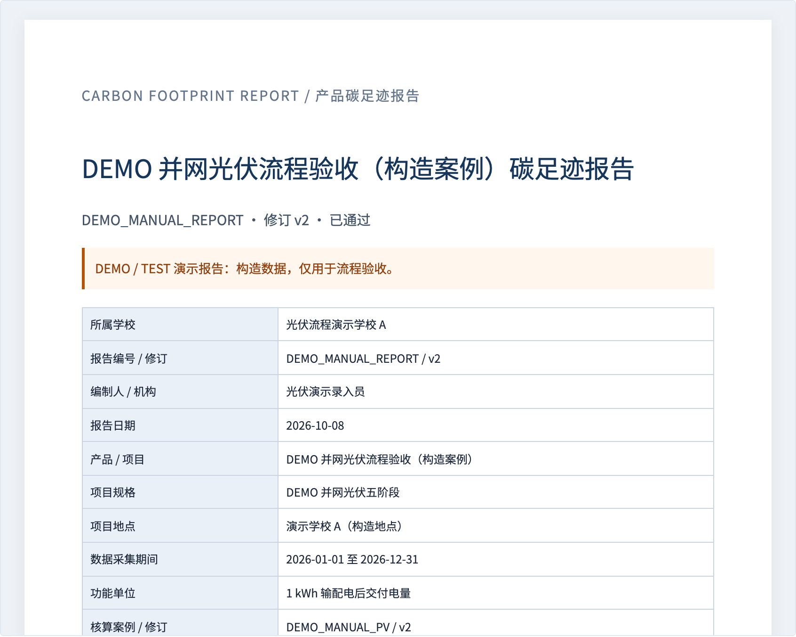

图 28 已通过修订的报告排版预览

1. 确认报告标题、编号、修订、日期和编制信息符合本次交付。
2. 检查项目范围、核算方法、数据质量说明、阶段结果与单位电量碳足迹。
3. 核对模型、规则、因子与证据追溯信息，并确认限制声明与资料用途一致。
4. 正文需要调整时返回报告工作台，在允许的草稿或新修订中修改；已提交正文不能原位修改。

## 31 账号设置和审计追溯

账号设置用于修改本人密码；平台管理员通过审计日志查看关键管理操作的操作者与时间。

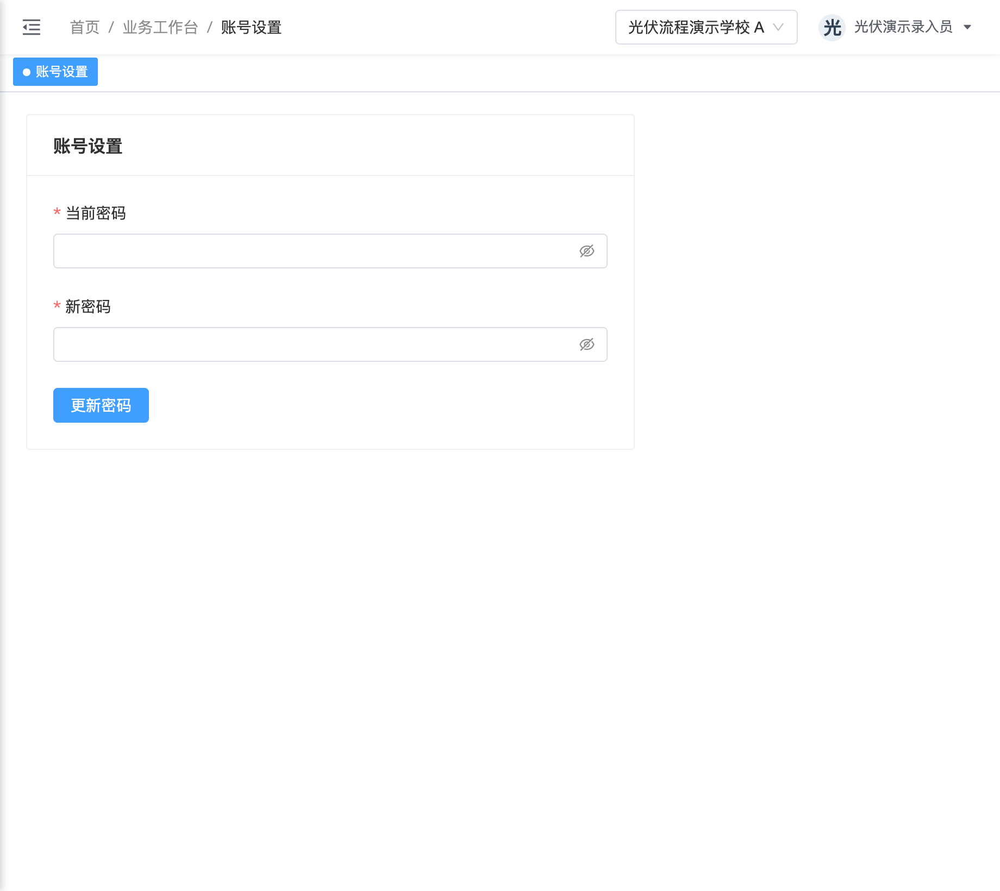

图 29 本人账号设置页面

1. 点击右上角姓名菜单进入“账号设置”，填写当前密码和新密码，按表单要求确认后保存。
2. 忘记当前密码时，由平台管理员在账号管理中重置；被停用或移除学校归属时，请由管理员核对状态。
3. 离开工作台时从姓名菜单退出登录。修改尚未保存时，先保存或明确放弃修改。
4. 平台管理员进入“审计日志”，核对学校、账号、归属和公共数据等关键操作记录；当前列表展示最近 100 条。

系统管理账号同样可以通过账号设置修改本人密码。审计记录用于追查发生了什么以及由谁操作，不代替学校业务审核。

## 32 常见问题和交付前检查

遇到问题时先核对当前学校、本人角色、资料状态和所选版本，再按下面的方法处理。

| 遇到的情况 | 处理方法 |
| --- | --- |
| 模型已填因子还要录公共数据吗 | 试算可以直接用模型内数值因子；正式计算需选择符合条件的公共因子和规则版本。 |
| 找不到公共因子或规则 | 确认已发布、未停用、用途适用；核对阶段、单位、对象、地域、技术和期间。 |
| 没有新建或审核按钮 | 核对学校角色与状态；创建人、最后编辑人、提交人不能自审。 |
| 提交审核按钮不可用 | 先保存当前输入并完成正式计算；输入改变后重新计算。 |
| 编辑年度后离开又丢失 | “应用到草稿”后还需点击案例的“保存草稿”。 |
| 报告预览没有刚修改的文字 | 先保存报告草稿；预览显示已保存版本。 |
| 生成报告没有可选运行 | 先让独立审核人员通过本校正式核算。 |
| 新版因子或模板没改变旧结果 | 历史运行和报告保留创建时快照；新案例或新报告主动选择新版本。 |
| 已通过报告没有导出按钮 | 选择已通过修订，并由学校管理员或核算员执行导出。 |
| PDF 提示繁忙或生成失败 | 稍后重试；仍失败时记录报告编号、修订和提示内容，联系运维人员检查服务。 |

### 交付前逐项确认

1. 学校、项目、模型、规则和因子版本正确；日期、范围与用途适用。
2. 活动数据与年度电量齐全，单位一致，证据可读取，正式结果对应当前输入。
3. 核算与报告均经独立审核，PDF 的报告编号及修订正确。

本说明书覆盖当前已接入的并网光伏流程。光热、风电核算与业务报告 Word 导出尚未接入；本说明书的可编辑 Word 文件用于资料维护，不代表平台已提供报告 Word 导出。

---

本说明书以当前界面与实际权限为准；升级平台后，应重新核对页面截图、操作名称和业务流程。
