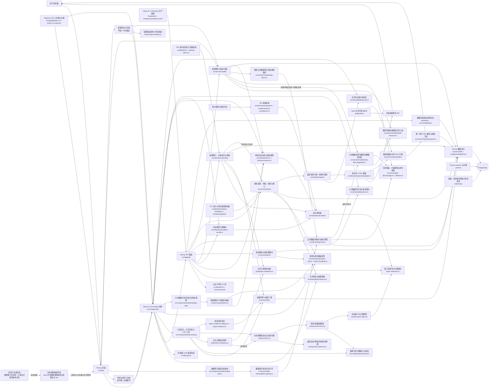

# 碳管理平台项目文件架构图

> 依据 2026-10-29 的工作区文件整理。主应用是 `Carbon-Management-Platform/`；`碳管理平台参考/` 是独立的前端原型，`计算公式模型参考文件/` 存放标准参考资料。下列文件树逐一说明工作区内的项目文件；`node_modules/`、`.next/` 与 `src/generated/prisma/` 等大量可再生文件仅说明目录用途；Git 与工具内部状态目录不作为项目文件逐项记录。

## 1. 总体架构



说明：当前主应用已实现登录、学校与账号管理、学校切换、公共数据版本、审计和碳足迹模型双轨发布。平台管理员维护公用模板；学校引用公用版本或自行建模，校内角色审核发布。模型版本可配置基于稳定 ID 的光伏计算阶段映射；公用因子 v2 记录用途、适用期、范围和来源，发布后内容不可改写，停用另存元数据和审计。旧版因子可复制为新草稿补全 v2 字段。`src/domain/calculation/` 使用十进制和单位换算计算并网光伏五阶段排放、年度电量和碳足迹，接受已解析模型及因子快照，不读取数据库。T04～T05 已接入学校案例修订、运行快照、幂等请求、证据附件与校内审核，并提供列表、活动数据、电量和结果页面；模型内因子可作试算，正式计算须选已发布公用因子及规则版本。T06 / M3c 已按用户指定的演示流程范围完成：离线独立验算、版本冻结回归及本机 DEMO 案例走通录入、计算、驳回修订和审核，保留三次修订及历史快照。演示初始化分为数据构造、资料初始化、流程验证和 CLI，复用已有领域服务；两校与独立账号用于验证隔离和禁止自审。T07 / M4 报告闭环已完成本轮工程与演示验收：只引用已审核正式运行，说明正文允许草稿保存，提交后冻结；独立审核、驳回/通过后的新修订及历史预览保留原版。纯报告模块解析固定来源并生成统一结构化文档与版本化 HTML；PDF 引擎嵌入中文字体、阻断网络，导出服务按审核修订唯一缓存并验证摘要，每次读取重新授权并审计。报告列表、表单、审核弹窗、来源卡片、预览及客户端流程按职责拆分，复用认证、学校权限、证据和未保存离开提醒。七页样张与机器结果存于 output/pdf/ 和 docs/acceptance/。本轮按复查顺序修复 F01～F09：规则和受控报告模板校验、404、兼容单位与业务追溯、分页年度和批量 CSV、附件复用、中文审核筛选、窄屏与长标题。所选公共报告模板快照随报告冻结并计入摘要，旧模板和 PDF 保留兼容。核算操作、审核、历史、年度编辑与批量工具按职责拆分；新增连接池、就绪探针、故障日志、生产配置与运维 CLI。阶段 8 / M5 本机工程演练已通过，包括 500 合成案例 / 20 并发与全表备份恢复一致性；实际生产容量、部署回滚与业务签认仍需目标环境和负责人确认。实际业务签认在正式业务启用前补充；参考原型、标准 PDF 和交付样张不是运行依赖。

图文使用说明书的正文与截图分别维护在 `Carbon-Management-Platform/docs/用户手册/` 及其 `images/` 子目录；可编辑 Word 和打印 PDF 存于 `output/docx/`、`output/pdf/`。说明书覆盖当前并网光伏业务流程，只作用户交付资料，未增加运行依赖或改变模块调用关系。

局域网访问复用现有认证与环境配置：`BETTER_AUTH_URL` 设置主要地址，`BETTER_AUTH_TRUSTED_ORIGINS` 显式列出额外可信登录来源；`next.config.ts` 读取两者的主机名生成开发服务的 `allowedDevOrigins`，使页面脚本及热更新可从这些地址访问。认证继续校验完整来源，未放开任意来源，也未新增业务模块。

公共数据展示由 `content-presentation.ts` 将因子、规则与报告模板容错转换为中文字段分组，`public-data-details.tsx` 统一渲染只读详情并默认折叠原始数据，`legacy-factor-preview.tsx` 在新版本表单中提供数值、用途和说明摘要。列表与旧版核对共用详情组件；展示转换不参与保存、发布校验或数据库写入。

页面时间戳与报告渲染共用 `src/shared/beijing-time.ts`，统一按北京时间显示。核算期间等日历日期直接显示，已归档的 PDF 仍从持久缓存读取。

核算基本信息、活动数据和年度电量共用 `accounting-date-picker.tsx` 录入日历日期。控件在日历值和 `YYYY-MM-DD` 字符串之间转换，各表单继续负责日期范围和完整运行年度校验。

生命周期活动数据按计算阶段分组。桌面端从侧栏选择活动项，窄屏端用下拉切换，同一阶段可逐项前后浏览。核算编辑页在 URL 中记录当前活动项，供草稿保存和刷新后恢复；试算及正式计算检查可打开目标阶段和表单并聚焦字段。各项字段统一向核算表单注册，供全量校验和保存。

正式计算清单和计算服务共用规则、因子及凭证完整性检查。活动因子下拉和计算内核共用适用性判断；输配电按核算参考日期核对，其余活动按发生日核对。批量凭证弹窗复用校内附件组件，按选中的活动和年度增补引用，逐条检查上限并随案例草稿保存。

模型版本页组合独立的 `model-reject-dialog.tsx`：弹窗通过 Ant Design 表单校验驳回理由，空值或纯空白时显示“驳回理由不能为空”并阻止提交；服务端继续重复校验。版本页负责状态流转请求，弹窗只在请求成功后关闭，失败时保留理由并展示错误。

2026-10-20 补充浏览器 UUID 兼容模块 `src/lib/uuid.ts`：模型阶段、大类、数据项新增及核算运行请求统一调用 `createUuid()`，优先使用原生 `randomUUID()`，在普通 HTTP 等不提供该方法的上下文中通过 `getRandomValues()` 生成标准 v4 UUID。兼容逻辑独立维护，不在组件或业务流程内重复实现；`tests/uuid.test.ts` 覆盖原生路径、缺少原生方法时的版本/变体位及 API UUID 契约兼容性。

2026-10-09 按用户要求清理本机演示数据库，保留管理员、光伏演示 A/B 学校、模型、因子、规则、核算与报告历史、附件及 PDF。清理记录和脱敏机器摘要分别在 `docs/2026-10-09演示数据清理记录.md` 与 `docs/acceptance/pv-demo-cleanup-20261009.json`；删除前的完整备份置于项目外私有临时目录，不增加应用运行依赖。

随后按用户要求新增并发布 `DEMO_PV_PUBLIC_TEMPLATE` v1 公用光伏模板示例，复用模型创建、发布、结构校验与计算模块。两校可查看，学校引用可复制全部内容；临时验证副本已移除。说明与完整机器记录见 `docs/2026-10-09光伏公用模板示例.md` 和 `docs/acceptance/pv-public-template-example-20261009.json`，应用代码和运行模块关系保持现有结构。

2026-10-29 按用户要求，将学校 A 中来源为“自行创建”的 15 个现有模型的 258 条数据项整理并发布到公共数据项库，保留 164 项现有因子和 94 项空缺，逐项记录原模型、阶段、大类及数据项来源。复用既有管理员创建、发布与审计、学校公共查询及模型选用解析服务，17 张原有业务表内容摘要保持一致。范围、明细与验收见 `docs/2026-10-29学校A自建模型数据项入库记录.md` 和 `docs/acceptance/school-a-model-data-items-20261029.json`；应用模块调用关系不变。

## 2. 文件树与逐文件用途

2026-10-29 新增独立公共数据项领域：`DataItem` 保存稳定编码，`DataItemVersion` 保存草稿、不可变发布内容、修订号及停用记录。查询与写入服务分开维护，复用平台管理员身份、单位目录及审计；一项最多一份草稿，并通过修订号阻止并发覆盖。此阶段建设公共库与管理员维护，模型选用流程及历史模型内容保持现有行为。

路径相对于工作区根目录 `碳管理平台/`。`page.tsx` 是页面入口，`layout.tsx` 是页面布局，`route.ts` 是 API 入口；括号目录 `(dashboard)` 是 Next.js 路由分组，不会出现在网址中。

随后接入模型公共数据项引用：学校用户及平台管理员搜索已发布未停用版本；新数据项保存来源版本和资料快照，保留模型内独立标识。同一大类阻止重复引用；服务端重新读取新引用的资料并锁定停用状态。已保存引用及从模板/历史版本继承的内容保持冻结；旧版自有项允许原样保留和合法格式归一，新增或改写须改为公共库选用，不批量改写历史资料。

数据项删除按当前版本执行：草稿、从未被引用的发布版本可删除并保留完整审计；已引用版本保留，只能停用。`DataItemUsage` 记录曾经使用过该版本的模型版本标识，删除/移除草稿引用后仍保留，并限制物理删除公共版本。迁移从全部模型（含归档）、核算与报告来源回填；保存、创建和复制模型版本时同事务记录引用。管理员列表合并留痕与现存模型引用统计，删除时加数据项/版本锁并复查，兼容旧记录且防止并发新引用。`DataItem.nextVersion` 保证同一数据项不复用已删除版本号，删除最后一份未引用版本时移除空数据项。

公共数据项正式发布时按编码接替旧版。发布服务按稳定引用追踪公用模板和各校模型。原有草稿在单位、来源及边界资料一致时自动更新两列因子的数值，资料有变化的引用由具备编辑权限的用户核对并更换。已发布模型以新版草稿承接升级，待审核版本在审核结束后按结果处理新版。发布、同步、自动删除同一数据项中从未被引用的旧发布版和完整审计在同一事务完成，曾被引用的旧版停用后保留。核算和报告可按各自保存的快照追溯。已发布过的数据项可按编码运行补同步脚本。

管理员数据项主表按照稳定编码筛选、统计和分页。当前发布版与草稿在同一行，停用版本在独立的历史抽屉按需分页。版本操作复用原有详情、表单及删除校验。

```text
碳管理平台/
├── Carbon-Management-Platform/  当前 Next.js 主应用
│   ├── .github/  自动化检查配置
│   │   └── workflows/  GitHub Actions 工作流
│   │       └── ci.yml  GitHub Actions：安装、校验、测试、类型检查和构建
│   ├── .next/  Next.js 开发/构建缓存与产物；自动生成
│   ├── docs/  实施计划、业务契约、验收记录与配图用户手册
│   │   ├── acceptance/  独立预期、来源摘要、流程机器结果与浏览器截图
│   │   │   ├── full-flow-20261007/  本轮独立临时库全流程复查证据；不含账号凭据
│   │   │   │   ├── 01-login.jpg  全流程复查的登录入口截图；不含登录凭据
│   │   │   │   ├── 03-rule-json-form.jpg  无完整计算结构的规则 JSON 负例录入截图
│   │   │   │   ├── 04-invalid-rule-published.jpg  负例规则被允许发布的复现证据
│   │   │   │   ├── 06-model-published.jpg  独立审核员发布合成学校模型的流程证据
│   │   │   │   ├── 07-case-validation.jpg  空核算输入触发字段级必填校验的证据
│   │   │   │   ├── 08-unit-diagnostic.jpg  中文活动单位被计算拒绝但错误定位仅显示内部路径的证据
│   │   │   │   ├── 09-calculation-results.jpg  合成五阶段计算结果与逐项结果可读性问题的证据
│   │   │   │   ├── 11-case-approved.jpg  合成核算通过独立审核并冻结输入的证据
│   │   │   │   ├── 12-report-editor.jpg  固定核算来源与报告说明编辑的流程证据
│   │   │   │   ├── 14-report-approved.jpg  合成报告通过独立审核的流程证据
│   │   │   │   ├── 15-report-preview.jpg  已通过报告预览及长标题孤字换行的证据
│   │   │   │   ├── 16-mobile-accounting.jpg  390 像素窄屏核算页面的横向溢出证据
│   │   │   │   ├── 17-cross-school-page-error.jpg  跨校核算详情返回通用错误页的复现证据
│   │   │   │   ├── 18-annual-energy-long-form.jpg  25 年电量卡片与远离保存按钮的操作效率证据
│   │   │   │   ├── 19-accounting-list.jpg  核算列表缺少筛选及状态显示英文的证据
│   │   │   │   ├── additional-checks.json  本轮异常 API/页面状态、核算修订后旧 PDF 冻结及修正样张摘要
│   │   │   │   ├── audit-result.json  本轮全流程测试摘要、独立预期、问题优先级、范围与临时环境清理结果
│   │   │   │   ├── browser-observations.json  25 年输入控件和页面高度、窄屏尺寸及异常页文案实测
│   │   │   │   └── T07-report-workflow-result.json  本轮重跑临时库 T07 报告权限、修订、PDF、隔离及浏览器回归结果
│   │   │   ├── pv-reference-handcalc.md  标准因子参考样例的独立四则运算及构造输入声明
│   │   │   ├── pv-demo-cleanup-20261009.json  本机光伏演示数据清理：删除与保留清单、私有备份摘要、原数据不变及登录/核算/报告/PDF复验结果；不含凭据
│   │   │   ├── school-a-model-data-items-20261029.json  学校 A 自建模型 258 项公共入库的完整字段、模型阶段来源、版本身份、同名差异及原数据不变验证
│   │   │   ├── pv-public-template-example-20261009.json  已发布公用光伏示例的完整模型快照、五阶段映射、参考验算、两校可见与真实引用验证；不含凭据
│   │   │   ├── T06-pv-demo-workflow-result.json  本机演示流程验收：三次修订、数值比对、隔离及历史记录
│   │   │   ├── T06-pv-reference-result.json  2026-10-07 工程验算：27 项比对、来源与源码摘要、业务签认缺口
│   │   │   ├── T07-report-demo-result.json  本机 T07 报告演示修订、冻结、PDF 摘要、隔离与逐页视觉验收记录
│   │   │   ├── T07-report-editor.png  本机 DEMO 报告 v3 草稿编辑界面的浏览器验收截图
│   │   │   ├── T07-report-history-preview.png  本机 DEMO 报告历史通过 v2 的中文预览截图；字体加载完毕且控制台无警告
│   │   │   ├── T07-report-workflow-result.json  独立临时库 T07 报告 API 与真实浏览器验收：权限、冻结、并发、篡改、PDF 和零控制台警告
│   │   │   └── flow-fixes-20261008/  F01～F09 修复、合成容量和恢复演练的最终证据，不含凭据
│   │   │       ├── annual-energy-compact.png  25 年分页电量、批量工具与保存后保留页签的截图
│   │   │       ├── mobile-accounting.png  390 像素无页面溢出的年度表格截图
│   │   │       ├── fixed-run-source.png  从固定历史运行快照展示模型、因子及证据的只读面板
│   │   │       ├── workflow-fixes-result.json  规则拒绝、模板冻结、404、单位校验、批量保存与窄屏回归机器结果
│   │   │       ├── release-result.json  静态检查、全流程、500 案例容量、全表恢复摘要及真实部署边界
│   │   │       ├── local-migration-result.json  本地增量迁移后的旧报告、正文摘要与 PDF 字节不变验证
│   │   │       ├── pdf-page-1.png  修复后中文 PDF 第 1 页的完整目视核对渲染
│   │   │       ├── pdf-page-2.png  修复后中文 PDF 第 2 页的完整目视核对渲染
│   │   │       ├── pdf-page-3.png  修复后中文 PDF 第 3 页的完整目视核对渲染
│   │   │       ├── pdf-page-4.png  修复后中文 PDF 第 4 页的完整目视核对渲染
│   │   │       ├── pdf-page-5.png  修复后中文 PDF 第 5 页的完整目视核对渲染
│   │   │       ├── pdf-page-6.png  修复后中文 PDF 第 6 页的完整目视核对渲染
│   │   │       └── local-service-result.json  开发服务重启后的健康、就绪、演示登录、核算页及旧 PDF 下载摘要检查
│   │   ├── 用户手册/  当前并网光伏流程的图文操作说明与截图维护资料
│   │   │   ├── images/  说明书使用的 29 张实际页面截图；均为独立演示资料
│   │   │   │   ├── 01-login.png  说明书图 1：登录页面的邮箱和密码入口
│   │   │   │   ├── 02-schools.png  说明书图 2：学校列表和新增学校入口
│   │   │   │   ├── 03-school-accounts.png  说明书图 3：学校账号工作区和成员角色
│   │   │   │   ├── 04-public-data.png  说明书图 4：公共数据版本列表
│   │   │   │   ├── 05-factor-basic.png  说明书图 5：排放因子草稿中的数值与活动单位
│   │   │   │   ├── 06-factor-scope.png  说明书图 6：排放因子的用途和适用范围
│   │   │   │   ├── 07-factor-source.png  说明书图 7：排放因子来源证据和版本依据
│   │   │   │   ├── 08-rule-config.png  说明书图 8：并网光伏规则的发布校验表单
│   │   │   │   ├── 09-report-template.png  说明书图 9：通用报告模板的标题和默认说明配置
│   │   │   │   ├── 11-public-models.png  说明书图 10：平台公用模型模板列表
│   │   │   │   ├── 12-model-list.png  说明书图 11：本校模型列表和公用模板入口
│   │   │   │   ├── 13-model-editor.png  说明书图 12：模型版本页面的基本信息表单
│   │   │   │   ├── 15-model-structure.png  说明书图 13：模型中的生命周期阶段与数据项
│   │   │   │   ├── 14-model-mapping.png  说明书图 14：光伏五阶段计算映射
│   │   │   │   ├── 17-create-case.png  说明书图 15：新建核算案例的模型版本选择
│   │   │   │   ├── 18-case-method.png  说明书图 16：核算案例基本信息与方法页签
│   │   │   │   ├── 19-activity-data.png  说明书图 17：活动量录入和公用因子版本选择
│   │   │   │   ├── 20-annual-energy.png  说明书图 18：运行年度电量表格与批量工具
│   │   │   │   ├── 21-annual-edit.png  说明书图 19：年度电量编辑与证据关联
│   │   │   │   ├── 22-calculation-results.png  说明书图 20：计算结果中的总量每度电足迹和阶段排放
│   │   │   │   ├── 23-fixed-source.png  说明书图 21：固定运行来源中的模型规则因子和证据
│   │   │   │   ├── 25-accounting-review.png  说明书图 22：核算审核通过弹窗
│   │   │   │   ├── 24-calculation-history.png  说明书图 23：核算修订和审核历史
│   │   │   │   ├── 27-create-report.png  说明书图 24：报告创建时选择固定核算来源和模板
│   │   │   │   ├── 28-report-editor.png  说明书图 25：报告草稿的固定来源和编辑入口
│   │   │   │   ├── 29-report-review.png  说明书图 26：报告审核意见弹窗
│   │   │   │   ├── 30-report-approved.png  说明书图 27：选择已通过历史修订并显示导出 PDF 入口
│   │   │   │   ├── 31-report-preview.png  说明书图 28：已通过修订的报告排版预览
│   │   │   │   └── 32-account-settings.png  说明书图 29：本人账号设置页面
│   │   │   ├── 截图说明.md  截图来源与图号索引、文件职责、维护步骤及交付检查记录
│   │   │   └── 碳管理平台使用说明书.md  用户手册文字源：角色、公共数据、模型、核算、审核、报告及常见问题
│   │   ├── 2026-10-07全流程复查记录.md  合成数据完整流程复查、截图复现、优先级、上线缺口及模块化现状
│   │   ├── T06光伏验收记录.md  T06 已完成的演示流程、登录资料、来源核对及后续正式资料要求
│   │   ├── T07报告验收记录.md  T07 / M4 已完成的报告流程、权限、PDF 与浏览器验收和后续边界
│   │   ├── 光伏核算规则映射与验算设计.md  光伏 v0.6 规则映射、T01～T07 完成证据及正式启用前的业务决策
│   │   ├── 碳管理平台从零到一开发流程.md  产品边界、技术方案、数据设计及分阶段计划
│   │   ├── 阶段3业务决策与权限.md  账号、学校、校内角色及公共数据规则
│   │   ├── 部署与运维手册.md  生产配置、容量边界、可执行备份恢复、预发布、回滚、日志告警和角色操作交接
│   │   ├── 2026-10-08全流程修复验收.md  F01～F09 修复验收、容量与恢复实测、模块拆分及正式部署待确认边界
│   │   ├── 2026-10-09演示数据清理记录.md  本机清理范围、完整备份、光伏演示保留清单及清理后登录/审核历史/PDF验证
│   │   ├── 2026-10-09光伏公用模板示例.md  公用光伏模板示例名称、编码、五阶段数据、学校引用方法、实际复制与原数据保留验证
│   │   └── 2026-10-29学校A自建模型数据项入库记录.md  自建模型入库范围、258 项按模型统计、缺失因子保留、服务验收与模块复用说明
│   ├── node_modules/  npm 安装的第三方依赖；自动生成
│   ├── output/  用户说明书与可交付演示产物；不作为运行依赖
│   │   ├── docx/  可编辑的用户文档交付版
│   │   │   └── 碳管理平台使用说明书.docx  32 节图文用户手册，含角色表、29 张截图及可点击目录
│   │   └── pdf/  用户说明书打印版与已审核 DEMO / 合成报告样张
│   │       ├── 碳管理平台使用说明书.pdf  33 页图文用户手册；嵌入中文字体、可搜索及逐页检查
│   │       ├── AUDIT_UI_REPORT_002-v1.pdf  本轮独立测试库合成核算 v2 的五页已审核报告；修正测试电量说明并逐页检查
│   │       ├── DEMO_REPORT_T07-v2.pdf  已审核 DEMO 报告 v2 的七页中文 PDF 样张，与数据库持久导出字节一致
│   │       └── SYN_TEMPLATE_REPORT-v1.pdf  公共模板冻结及长标题平衡换行的六页中文合成验收报告
│   ├── prisma/  数据库 schema 与不可变版本迁移
│   │   ├── migrations/  按时间执行的数据库迁移和迁移锁
│   │   │   ├── 20260923000000_init/  数据库迁移：初始学校、用户、学校成员等基础表结构
│   │   │   │   └── migration.sql  初始学校、用户、学校成员等基础表结构
│   │   │   ├── 20260923083907_stage3_identity_access/  数据库迁移：阶段 3 的认证、平台角色、公共数据及审计表变更
│   │   │   │   └── migration.sql  阶段 3 的认证、平台角色、公共数据及审计表变更
│   │   │   ├── 20260924000000_account_deletion/  数据库迁移：增加账号删除时间，保留历史关联所需的匿名记录
│   │   │   │   └── migration.sql  增加账号删除时间，保留历史关联所需的匿名记录
│   │   │   ├── 20260924010000_footprint_models/  数据库迁移：公用/学校模型、版本状态、来源与审核关系
│   │   │   │   └── migration.sql  公用/学校模型、版本状态、来源与审核关系
│   │   │   ├── 20260924020000_model_archive/  数据库迁移：模型归档时间及未归档编码的唯一约束
│   │   │   │   └── migration.sql  模型归档时间及未归档编码的唯一约束
│   │   │   ├── 20260929010000_factor_retirement/  数据库迁移：公共因子版本的停用时间、原因及查询索引
│   │   │   │   └── migration.sql  公共因子版本的停用时间、原因及查询索引
│   │   │   ├── 20260929020000_accounting_cases/  数据库迁移：核算案例、修订、运行、审核及证据附件关系表
│   │   │   │   └── migration.sql  核算案例、修订、运行、审核及证据附件关系表
│   │   │   ├── 20261007010000_report_workflow/  数据库迁移：报告、修订状态、审核元数据和唯一 PDF 导出快照迁移
│   │   │   │   └── migration.sql  报告、修订状态、审核元数据和唯一 PDF 导出快照迁移
│   │   │   ├── migration_lock.toml  Prisma 迁移使用的数据库类型锁定信息
│   │   │   ├── 20261008010000_public_report_templates/  公共报告模板快照及核算案例更新时间索引迁移
│   │   │   │   └── migration.sql  为报告增加可空固定模板快照，兼容旧报告摘要；新增案例查询索引
│   │   │   ├── 20261029010000_public_data_items/  公共数据项及版本库增量迁移
│   │   │   │   └── migration.sql  稳定编码、版本内容、状态约束、单草稿唯一索引及关联；保留已有业务表
│   │   │   ├── 20261029020000_data_item_deletion/  公共数据项删除与历史引用保护迁移
│   │   │   │   └── migration.sql  增加引用留痕、从模型/核算/报告回填引用，以及不复用已删除版本号的分配计数
│   │   │   └── 20261117010000_current_data_item_versions/  停用并行可选的旧版并约束每项仅有一个当前发布版
│   │   │       └── migration.sql  旧版本停用元数据回填及可用版本唯一索引
│   │   └── schema.prisma  数据表、枚举、关联关系及 Prisma Client 生成设置
│   ├── public/  浏览器可读取的静态资源
│   │   └── fonts/  预览与服务端 PDF 共用的 Noto 简体中文字体及许可
│   │       ├── NotoSans-LICENSE.txt  Noto 字体的 SIL Open Font License 许可和版权说明
│   │       └── NotoSansSC-Regular.otf  Noto 简体中文开放字体；报告预览及 PDF 复用并嵌入
│   ├── scripts/  管理员初始化、独立验算、演示 CLI 与集成验收入口
│   │   ├── demo/  本地光伏构造案例的配置、初始化和流程验证
│   │   │   ├── pv-data.ts  演示账号声明、参考输入及附件占位数据构造
│   │   │   ├── pv-setup.ts  复用领域服务初始化演示学校、账号、模型、规则和因子
│   │   │   ├── pv-catalog.ts  首次显式演示初始化时建立并引用公共数据项；复用已有历史模型时不修改
│   │   │   ├── pv-workflow.ts  演示案例录入、计算、驳回修订、审核、历史与隔离验证
│   │   │   └── report-workflow.ts  复用报告领域服务走通本机演示编辑、驳回、修订、通过、导出和历史隔离
│   │   ├── integration/  临时库各业务流程及真实浏览器回归
│   │   │   ├── accounting-acceptance.mjs  T06 临时库回归：版本冻结、重算、修订、旧结果及演示初始化/登录/API
│   │   │   ├── data-items.mjs  公共数据项临时库回归：权限、版本冻结、并发、停用、分页搜索与审计
│   │   │   ├── model-data-item-upgrades.mjs  公用及学校模型跨校联动、审核、历史快照和补同步回归
│   │   │   ├── data-items-browser.mjs  公共数据项真实浏览器流程、字段校验、版本追溯、窄屏及零控制台警告验收
│   │   │   ├── data-item-deletion.mjs  删除权限、审计、历史/归档/已移除引用保护、版本号不复用、回填及并发回归
│   │   │   ├── data-item-deletion-browser.mjs  删除确认/取消、引用禁删、过期页面冲突、停用入口及窄屏浏览器验收
│   │   │   ├── model-data-items.mjs  模型引用临时库验收与通过公共库构造新建模型夹具
│   │   │   ├── model-data-items-browser.mjs  模型搜索、多页勾选、更换保留标识、移除、重新加载及窄屏浏览器验收
│   │   │   ├── report-workflow.mjs  临时库报告闭环：权限、冻结、PDF 一致性、并发、篡改及真实浏览器流程回归
│   │   │   └── workflow-fixes.mjs  规则、模板冻结、404、活动阶段切换与缺项定位、25 年批量录入、窄屏和长标题的真实 API 与浏览器回归
│   │   ├── bootstrap-admin.ts  命令行初始化首个超级管理员账号与平台角色
│   │   ├── seed-pv-demo.ts  演示验收 CLI；限制本机数据库、保留已有案例并输出结果
│   │   ├── seed-report-demo.ts  本机报告演示 CLI；复用既有核算，保留历史，并可输出验收 JSON 和 PDF
│   │   ├── stage3-smoke.mjs  阶段 3～7 临时数据库集成测试入口；创建、迁移、启动、验收与清理
│   │   ├── sync-data-item-models.ts  按数据项编码补同步当前发布版涉及的公用模板和学校模型，记录管理员审计
│   │   ├── verify-pv-acceptance.ts  T06 离线入口；核对凭证文件摘要并输出数值比对及业务资料缺口
│   │   └── ops/  预发布容量、备份恢复与部署配置验证工具，演练限定合成临时数据库
│   │       ├── postgres-tools.mjs  通过独立环境变量调用 PostgreSQL 备份恢复工具，不在命令行暴露密码
│   │       ├── recovery-check.mjs  合成数据备份、独立恢复、全表字节摘要与迁移复跑验证，自动清理
│   │       ├── load-check.mjs  合成案例与有界并发 API 容量演练、连接峰值和跨校校验，自动清理夹具
│   │       ├── deployment-check.mjs  验证实际 HTTPS 域名、非占位密钥、已迁移数据库与 PDF 渲染依赖
│   │       └── database-backup.mjs  数据库私有备份、SHA-256 清单与仅允许新库的恢复 CLI；演练复用相同实现
│   ├── src/  应用源码；按页面、组件、契约、纯领域和服务端职责拆分
│   │   ├── app/  Next.js 页面、布局和 HTTP API
│   │   │   ├── (dashboard)/  学校业务工作台路由分组
│   │   │   │   ├── account/  account 页面及子路由
│   │   │   │   │   └── page.tsx  学校工作台账号设置路由，加载共享组件
│   │   │   │   ├── accounting/  accounting 页面及子路由
│   │   │   │   │   ├── [id]/  按对象或版本 ID 加载的详情子路由
│   │   │   │   │   │   └── page.tsx  案例修订详情、可用因子和规则装配
│   │   │   │   │   ├── page.tsx  本校核算案例列表和新建入口
│   │   │   │   │   └── not-found.tsx  核算详情不存在或跨校时的 404 与返回案例列表入口
│   │   │   │   ├── models/  models 页面及子路由
│   │   │   │   │   ├── [id]/  按对象或版本 ID 加载的详情子路由
│   │   │   │   │   │   └── versions/  模型版本详情路由分组
│   │   │   │   │   │       └── [versionId]/  按对象或版本 ID 加载的详情子路由
│   │   │   │   │   │           └── page.tsx  本校模型编辑及公用模板只读子页面
│   │   │   │   │   └── page.tsx  本校模型和公用模板列表、校内权限装配
│   │   │   │   ├── reports/  本校报告列表与详情路由
│   │   │   │   │   ├── [id]/  按对象或版本 ID 加载的详情子路由
│   │   │   │   │   │   └── page.tsx  本校报告详情路由；无效或跨校 ID 返回 404，装配修订工作台
│   │   │   │   │   └── page.tsx  本校报告列表、已审核运行选择与生成入口；支持核算页面带 runId 跳转
│   │   │   │   └── layout.tsx  登录及学校归属校验，装配工作台外壳
│   │   │   ├── admin/  平台系统管理页面
│   │   │   │   ├── account/  account 页面及子路由
│   │   │   │   │   └── page.tsx  系统管理账号设置路由，加载共享组件
│   │   │   │   ├── audit/  audit 页面及子路由
│   │   │   │   │   └── page.tsx  查询最近审计日志并展示
│   │   │   │   ├── data-items/  公共数据项库管理路由
│   │   │   │   │   └── page.tsx  校验平台管理员身份，读取筛选参数并装配分页管理页
│   │   │   │   ├── models/  models 页面及子路由
│   │   │   │   │   ├── [id]/  按对象或版本 ID 加载的详情子路由
│   │   │   │   │   │   └── versions/  模型版本详情路由分组
│   │   │   │   │   │       └── [versionId]/  按对象或版本 ID 加载的详情子路由
│   │   │   │   │   │           └── page.tsx  平台公用模板版本编辑与查看子页面
│   │   │   │   │   └── page.tsx  平台公用模型模板管理页面
│   │   │   │   ├── public-data/  public-data 页面及子路由
│   │   │   │   │   └── page.tsx  查询公共数据版本并装配管理界面
│   │   │   │   ├── schools/  schools 页面及子路由
│   │   │   │   │   └── page.tsx  查询学校与账号，装配统一管理工作区
│   │   │   │   ├── users/  users 页面及子路由
│   │   │   │   │   └── page.tsx  旧账号地址重定向到全部账号视图
│   │   │   │   ├── layout.tsx  管理员身份校验，装配管理端外壳
│   │   │   │   └── page.tsx  /admin 重定向到学校管理
│   │   │   ├── api/  服务端 HTTP 接口
│   │   │   │   ├── accounting/  API 路由分组：accounting
│   │   │   │   │   ├── cases/  API 路由分组：cases
│   │   │   │   │   │   ├── [id]/  按对象 ID 定位的授权 API
│   │   │   │   │   │   │   ├── review/  API 路由分组：review
│   │   │   │   │   │   │   │   └── route.ts  POST；非自审核通过或驳回
│   │   │   │   │   │   │   ├── revisions/  API 路由分组：revisions
│   │   │   │   │   │   │   │   └── route.ts  POST；从已审核或驳回版本创建修订
│   │   │   │   │   │   │   ├── runs/  API 路由分组：runs
│   │   │   │   │   │   │   │   └── route.ts  POST；幂等计算与诊断
│   │   │   │   │   │   │   ├── submit/  API 路由分组：submit
│   │   │   │   │   │   │   │   └── route.ts  POST；锁定当前正式运行并提交
│   │   │   │   │   │   │   └── route.ts  GET/PATCH；案例详情和乐观锁草稿保存
│   │   │   │   │   │   └── route.ts  GET/POST；本校案例列表和创建
│   │   │   │   │   └── runs/  API 路由分组：runs
│   │   │   │   │       └── [id]/  按对象 ID 定位的授权 API
│   │   │   │   │           └── route.ts  GET；按学校授权读取完整运行快照
│   │   │   │   ├── admin/  API 路由分组：admin
│   │   │   │   │   ├── data-items/  仅平台管理员可访问的公共数据项 API
│   │   │   │   │   │   ├── [id]/  按公共数据项版本 ID 定位
│   │   │   │   │   │   │   ├── new-version/  从指定已发布版本创建下一版本草稿
│   │   │   │   │   │   │   │   └── route.ts  POST；校验来源及单草稿约束
│   │   │   │   │   │   │   ├── publish/  数据项发布接口
│   │   │   │   │   │   │   │   └── route.ts  POST；校验并发布数据项、接替旧版、汇总公用及学校模型更新
│   │   │   │   │   │   │   ├── retire/  数据项版本停用接口
│   │   │   │   │   │   │   │   └── route.ts  POST；记录停用原因、状态和审计
│   │   │   │   │   │   │   └── route.ts  PATCH 保存草稿 / DELETE 按修订号校验并删除未引用版本
│   │   │   │   │   │   ├── history/  按数据项身份读取历史的管理员接口
│   │   │   │   │   │   │   └── route.ts  GET；分页读取某一编码的停用版本和引用记录
│   │   │   │   │   │   └── route.ts  GET 分页搜索 / POST 新建公共数据项草稿
│   │   │   │   │   ├── memberships/  API 路由分组：memberships
│   │   │   │   │   │   └── route.ts  POST/DELETE；设置或移除账号的学校归属
│   │   │   │   │   ├── models/  API 路由分组：models
│   │   │   │   │   │   └── route.ts  POST；平台管理员创建公用模板
│   │   │   │   │   ├── public-data/  API 路由分组：public-data
│   │   │   │   │   │   ├── [id]/  按对象 ID 定位的授权 API
│   │   │   │   │   │   │   ├── publish/  API 路由分组：publish
│   │   │   │   │   │   │   │   └── route.ts  POST；发布公共数据版本
│   │   │   │   │   │   │   ├── retire/  API 路由分组：retire
│   │   │   │   │   │   │   │   └── route.ts  POST；记录因子停用原因和审计
│   │   │   │   │   │   │   └── route.ts  PATCH；编辑未发布草稿
│   │   │   │   │   │   └── route.ts  POST；新建公共数据草稿
│   │   │   │   │   ├── schools/  API 路由分组：schools
│   │   │   │   │   │   ├── [id]/  按对象 ID 定位的授权 API
│   │   │   │   │   │   │   └── route.ts  PATCH；改学校名称或启停状态
│   │   │   │   │   │   └── route.ts  POST；创建学校
│   │   │   │   │   └── users/  API 路由分组：users
│   │   │   │   │       ├── [id]/  按对象 ID 定位的授权 API
│   │   │   │   │       │   ├── password/  API 路由分组：password
│   │   │   │   │       │   │   └── route.ts  POST；重置账号密码
│   │   │   │   │       │   └── route.ts  PATCH/DELETE；改账号或删除非平台管理员账号
│   │   │   │   │       └── route.ts  POST；创建学校账号
│   │   │   │   ├── auth/  API 路由分组：auth
│   │   │   │   │   └── [...all]/  Better Auth 认证端点路由
│   │   │   │   │       └── route.ts  Better Auth 通用认证接口；屏蔽其管理端点
│   │   │   │   ├── files/  API 路由分组：files
│   │   │   │   │   ├── [id]/  按对象 ID 定位的授权 API
│   │   │   │   │   │   └── route.ts  GET；本校授权下载附件
│   │   │   │   │   └── route.ts  POST；本校证据附件上传
│   │   │   │   ├── health/  API 路由分组：health
│   │   │   │   │   └── route.ts  GET /api/health；仅报告应用进程状态
│   │   │   │   ├── model-versions/  API 路由分组：model-versions
│   │   │   │   │   └── [id]/  按对象 ID 定位的授权 API
│   │   │   │   │       ├── transition/  API 路由分组：transition
│   │   │   │   │       │   └── route.ts  POST；提交、发布或驳回版本
│   │   │   │   │       └── route.ts  PATCH/DELETE；编辑或删除指定草稿版本
│   │   │   │   ├── models/  API 路由分组：models
│   │   │   │   │   ├── [id]/  按对象 ID 定位的授权 API
│   │   │   │   │   │   ├── versions/  API 路由分组：versions
│   │   │   │   │   │   │   └── route.ts  POST；从已发布模型创建新版本
│   │   │   │   │   │   └── route.ts  DELETE；仅归档所有版本均已发布的整个模型
│   │   │   │   │   └── route.ts  POST；创建本校模型或引用公用模板
│   │   │   │   ├── data-items/  已登录用户可读取的公共数据项目录
│   │   │   │   │   └── route.ts  GET；仅搜索已发布未停用版本，分页且不缓存，不提供管理写入
│   │   │   │   ├── public-data/  API 路由分组：public-data
│   │   │   │   │   └── route.ts  GET；向学校用户返回已发布公共数据
│   │   │   │   ├── report-revisions/  报告历史修订的授权预览与 PDF 生成/下载 API
│   │   │   │   │   └── [id]/  按对象 ID 定位的授权 API
│   │   │   │   │       ├── pdf/  API 路由分组：pdf
│   │   │   │   │       │   └── route.ts  POST 幂等生成 / GET 授权下载审核版 PDF；返回摘要且禁止缓存
│   │   │   │   │       └── preview/  API 路由分组：preview
│   │   │   │   │           └── route.ts  校内授权的历史报告 HTML 预览；复用 PDF 模板并阻止脚本注入
│   │   │   │   ├── reports/  报告列表、创建与说明编辑/审核/修订 API
│   │   │   │   │   ├── [id]/  按对象 ID 定位的授权 API
│   │   │   │   │   │   ├── review/  API 路由分组：review
│   │   │   │   │   │   │   └── route.ts  审核资格、当前修订及冻结摘要复核 API
│   │   │   │   │   │   ├── revisions/  API 路由分组：revisions
│   │   │   │   │   │   │   └── route.ts  从已通过或驳回的报告创建新修订 API
│   │   │   │   │   │   ├── submit/  API 路由分组：submit
│   │   │   │   │   │   │   └── route.ts  提交正文完整性校验并冻结摘要 API
│   │   │   │   │   │   └── route.ts  报告详情与带修订 ID、正文版本的草稿保存 API
│   │   │   │   │   └── route.ts  本校报告列表、已审核运行选项及报告创建 API
│   │   │   │   ├── schools/  API 路由分组：schools
│   │   │   │   │   └── active/  API 路由分组：active
│   │   │   │   │       └── route.ts  POST；校验成员身份并写入当前学校 Cookie
│   │   │   │   └── ready/  数据库及最新报告结构就绪检查
│   │   │   │       └── route.ts  无缓存就绪探针；数据库不可用时返回 503 和排障编号
│   │   │   ├── login/  login 页面及子路由
│   │   │   │   └── page.tsx  登录表单及认证客户端交互，使用 Tailwind 工具类
│   │   │   ├── no-school/  no-school 页面及子路由
│   │   │   │   └── page.tsx  已登录但没有可用学校时的提示页
│   │   │   ├── error.tsx  页面运行错误的重试界面
│   │   │   ├── globals.css  Tailwind 主题、工具类入口及基础重置
│   │   │   ├── layout.tsx  根布局、页面元数据、Ant Design 注册与主题 Provider
│   │   │   ├── not-found.tsx  404 页面
│   │   │   └── page.tsx  站点根路径；重定向到 /models
│   │   ├── components/  Ant Design 页面区域、表单、表格与客户端流程
│   │   │   ├── account/  account 功能的独立界面组件
│   │   │   │   └── account-settings.tsx  两个账号设置路由共用的修改密码组件
│   │   │   ├── accounting/  accounting 功能的独立界面组件
│   │   │   │   ├── accounting-date-picker.tsx  核算表单共用的日历选择器、日期格式转换和必填日期校验
│   │   │   │   ├── accounting-editor.tsx  组合核算分区、运行选择和历史；保存后恢复页签和活动项并协调缺项定位
│   │   │   │   ├── accounting-list.tsx  核算案例表格与新建表单
│   │   │   │   ├── activity-lines.tsx  按阶段分组并切换活动项；仅展示当前项，供全量表单校验
│   │   │   │   ├── activity-item-selector.tsx  桌面紧凑活动项列表和窄屏可搜索下拉切换
│   │   │   │   ├── activity-item-form.tsx  单项数据状态、活动量、因子、凭证等字段及校验
│   │   │   │   ├── activity-factor-field.tsx  活动因子选项、适用期与核对日期匹配，提示模型缺省因子
│   │   │   │   ├── annual-energy.tsx  年度分页表格与全量电量校验，组合单年编辑和批量工具
│   │   │   │   ├── case-method-form.tsx  核算期间、场景参数和规则版本表单
│   │   │   │   ├── evidence-upload.tsx  校内证据上传、原文件名展示、已有证据复用及引用管理
│   │   │   │   ├── batch-evidence-dialog.tsx  选择活动、年度和共用凭证，确认后更新草稿
│   │   │   │   ├── batch-evidence.ts  建立批量凭证目标、去重追加并在更新前检查附件上限
│   │   │   │   ├── run-results.tsx  生命周期顺序汇总、业务可读逐项追溯及固定来源面板入口
│   │   │   │   ├── types.ts  案例、修订、因子和运行的页面类型
│   │   │   │   ├── use-accounting-actions.ts  核算保存、计算、提交、修订和审核客户端流程；维护忙碌及未保存状态
│   │   │   │   ├── accounting-review-dialog.tsx  核算审核意见表单和弹窗；驳回原因校验及审核请求组合
│   │   │   │   ├── accounting-history.tsx  修订与审核历史表；中文状态及审核意见展示
│   │   │   │   ├── accounting-toolbar.tsx  固定核算操作栏；组合保存、试算、正式计算、提交和独立审核入口
│   │   │   │   ├── accounting-diagnostics.tsx  将计算诊断转换为业务字段名称；提供跳转并聚焦错误字段
│   │   │   │   ├── production-checklist.tsx  汇总正式计算缺项并按录入页签分组，支持跳到对应字段
│   │   │   │   ├── run-trace.ts  只读取选定运行快照，装配名称、原始量、归一单位、因子版本和换算结果
│   │   │   │   ├── run-snapshot-drawer.tsx  运行固定来源只读抽屉；展示模型、规则、因子、年度电量及证据摘要
│   │   │   │   ├── evidence-library.tsx  校内证据元数据加载与上传缓存，供附件选择器复用
│   │   │   │   ├── annual-energy-data.ts  年度日期生成、CSV 模板与严格导入解析，保留已有附件引用
│   │   │   │   ├── annual-energy-row-dialog.tsx  单年度编辑与完整年、数量和证据字段校验
│   │   │   │   ├── annual-energy-tools.tsx  缺失年度批量生成、CSV 下载和导入确认
│   │   │   │   ├── accounting-list-filters.tsx  核算案例编码、项目名称、中文状态及待审核筛选
│   │   │   │   ├── accounting-list-table.tsx  核算案例列表、状态标签、排序与分页
│   │   │   │   └── create-case-dialog.tsx  新建核算案例表单和字段校验
│   │   │   ├── admin/  admin 功能的独立界面组件
│   │   │   │   ├── data-items/  公共数据项库管理员界面
│   │   │   │   │   ├── data-item-filters.tsx  编码、名称、规格、厂家关键字及状态、单位筛选表单
│   │   │   │   │   ├── data-item-dialog.tsx  新建、编辑、发布及新版本表单，字段级校验和未保存提醒
│   │   │   │   │   ├── data-item-table.tsx  按编码排列当前发布版、草稿与历史入口的数据项主表
│   │   │   │   │   ├── data-item-history-drawer.tsx  停用版本、因子、停用原因、引用及历史分页抽屉
│   │   │   │   │   ├── data-item-version-actions.tsx  主表与历史抽屉共用的版本级查看、编辑、删除和发布操作
│   │   │   │   │   ├── data-item-details.tsx  数据项完整资料、发布状态及停用原因只读抽屉
│   │   │   │   │   ├── retire-data-item-dialog.tsx  停用原因表单和状态流转确认
│   │   │   │   │   ├── delete-data-item-dialog.tsx  当前版本删除确认、操作范围、修订冲突及引用保护错误反馈
│   │   │   │   │   └── data-items-manager.tsx  装配筛选、表格、版本维护和公用模板升级反馈
│   │   │   │   ├── public-data/  public-data 功能的独立界面组件
│   │   │   │   │   ├── content-presentation.ts  因子、规则和模板的容错解析、中文字段分组、枚举与单位展示映射
│   │   │   │   │   ├── emission-factor-fields.tsx  公用排放因子 v2 数值、适用性与证据表单
│   │   │   │   │   ├── factor-form.ts  因子 v2 内容与表单字段的双向转换
│   │   │   │   │   ├── legacy-factor-preview.tsx  旧版本因子数值、用途和说明摘要；详情默认折叠并复用公共详情组件
│   │   │   │   │   ├── public-data-details.tsx  三类公共数据的响应式中文分组详情、空值提示与默认折叠的原始数据
│   │   │   │   │   ├── public-data-dialog.tsx  按因子、规则和受控报告模板组合结构化字段与发布校验
│   │   │   │   │   ├── public-data-table.tsx  公共数据版本列表、中文详情展开与行操作
│   │   │   │   │   ├── types.ts  公共数据行、表单类型与类型名称
│   │   │   │   │   ├── rule-form.ts  规则表单与版本化规则内容互转；固定当前并网方法并保留未完成草稿
│   │   │   │   │   ├── rule-config-fields.tsx  规则用途、标准引用、适用期及方法确认表单；发布字段级校验
│   │   │   │   │   ├── report-template-form.ts  公共报告模板结构与表单之间的转换
│   │   │   │   │   └── report-template-fields.tsx  用途、确认依据、标题后缀和默认说明的结构化表单
│   │   │   │   ├── schools/  schools 功能的独立界面组件
│   │   │   │   │   ├── school-dialog.tsx  学校新建与编辑弹窗
│   │   │   │   │   ├── schools-filter.tsx  学校搜索与状态筛选
│   │   │   │   │   ├── schools-table.tsx  学校列表及行操作
│   │   │   │   │   └── types.ts  学校列表与表单类型
│   │   │   │   ├── users/  users 功能的独立界面组件
│   │   │   │   │   ├── assign-existing-dialog.tsx  将已有账号分配到指定学校的表单弹窗
│   │   │   │   │   ├── create-account-form.tsx  新建账号表单
│   │   │   │   │   ├── edit-account-form.tsx  编辑账号表单
│   │   │   │   │   ├── password-reset-form.tsx  重置密码表单
│   │   │   │   │   ├── school-membership-form.tsx  学校归属与角色表单
│   │   │   │   │   ├── types.ts  账号、学校选项及表单类型
│   │   │   │   │   ├── use-users-actions.ts  账号和学校归属操作的客户端状态与请求流程
│   │   │   │   │   ├── users-dialogs.tsx  账号管理弹窗的切换与确认逻辑
│   │   │   │   │   ├── users-filter.tsx  账号关键字、学校及状态筛选
│   │   │   │   │   └── users-table.tsx  账号列表、角色标签和行操作
│   │   │   │   ├── admin-shell.tsx  系统管理导航、工作台切换及退出登录
│   │   │   │   ├── api.ts  管理界面统一请求与错误处理函数
│   │   │   │   ├── audit-table.tsx  审计日志表格
│   │   │   │   ├── public-data-manager.tsx  公共数据页面状态与保存、发布操作
│   │   │   │   ├── school-accounts-workspace.tsx  按学校与全部账号视图的路由和内容组合
│   │   │   │   ├── schools-manager.tsx  学校页面状态与保存、启停操作
│   │   │   │   └── users-manager.tsx  按学校或全局展示账号、筛选与操作界面
│   │   │   ├── backend/  backend 功能的独立界面组件
│   │   │   │   ├── header.tsx  顶栏、面包屑及账号菜单
│   │   │   │   ├── navigation-guard.ts  后台程序跳转的未保存修改拦截事件
│   │   │   │   ├── navigation.tsx  后台侧栏及移动端抽屉导航
│   │   │   │   ├── route-tabs.tsx  已访问页面的可关闭页签
│   │   │   │   └── use-unsaved-changes-warning.ts  模型与核算共用的未保存离开确认
│   │   │   ├── models/  models 功能的独立界面组件
│   │   │   │   ├── model-basic-details.tsx  已发布及只读模型基本信息的清晰展示
│   │   │   │   ├── model-basic-form.tsx  模型基本信息编辑、只读详情切换与字段级 rules
│   │   │   │   ├── model-boundary-diagram-field.tsx  系统边界图空态、预览、上传与移除
│   │   │   │   ├── model-calculation-profile.tsx  光伏阶段和数据项计算映射编辑区
│   │   │   │   ├── model-create-dialog.tsx  新建模型与引用公用模板表单
│   │   │   │   ├── data-item-picker.tsx  组合公共目录搜索、多选、更换版本与跨页选中摘要；返回数据与对应分页参数成组使用
│   │   │   │   ├── data-item-picker-filters.tsx  数据项名称、编码、规格、厂家关键字和活动单位筛选
│   │   │   │   ├── data-item-picker-table.tsx  当前可用数据项分页、资料展开、批量/单选及重复引用禁选
│   │   │   │   ├── use-data-item-catalog.ts  只读目录请求、取消过期请求、错误与重试状态；按请求参数和重试次数隔离结果，切换分页或筛选时立即进入加载状态
│   │   │   │   ├── model-item-table.tsx  模型内冻结资料、公共来源版本/旧资料标记、详情展开、更换与移除
│   │   │   │   ├── model-list-table.tsx  按模型归拢最新与历史版本、状态及模型级操作
│   │   │   │   ├── model-reject-dialog.tsx  模型驳回理由表单、必填与纯空白校验、提交反馈及成功后关闭
│   │   │   │   ├── model-structure-editor.tsx  阶段、大类结构编辑及名称校验
│   │   │   │   ├── model-version-editor.tsx  版本页面状态、表单校验、草稿并发保护和数据项升级提示
│   │   │   │   ├── model-workbench.tsx  本校/公用模型列表、创建、草稿删除和模型归档入口
│   │   │   │   └── types.ts  模型与版本的界面类型、状态名称和子页面地址生成
│   │   │   ├── reports/  报告列表、正文、审核、来源、历史预览与操作流程的独立组件
│   │   │   │   ├── create-report-dialog.tsx  已审核运行选择和报告编号表单，字段级校验
│   │   │   │   ├── report-content-form.tsx  只编辑说明正文的 Ant Design 表单；草稿保存和提交校验分离
│   │   │   │   ├── report-filter.tsx  报告关键字和状态筛选工具栏
│   │   │   │   ├── report-list.tsx  报告列表筛选、新建流程及子组件组合
│   │   │   │   ├── report-preview.tsx  当前或历史保存版本的授权 HTML 排版预览
│   │   │   │   ├── report-review-dialog.tsx  通过或驳回的审核意见表单；必填和长度校验
│   │   │   │   ├── report-source-summary.tsx  固定结果、案例、模板及校内证据附件；使用当前 Listy 列表组件
│   │   │   │   ├── report-table.tsx  报告表格和最新修订状态展示
│   │   │   │   ├── report-workbench.tsx  报告工作台装配、历史版本切换、权限操作和未保存修改保护
│   │   │   │   ├── types.ts  报告列表、正式运行选项、修订和来源的客户端数据类型
│   │   │   │   └── use-report-actions.ts  报告保存、校验后提交、修订、审核及授权 PDF 下载的客户端流程
│   │   │   ├── app-shell.tsx  学校工作台导航、学校切换及退出登录
│   │   │   ├── backend-shell.tsx  组合后台导航、顶栏、页签和主内容区
│   │   │   ├── module-landing.tsx  尚未实现业务模块的统一占位内容
│   │   │   ├── providers.tsx  Ant Design 中文语言、主题及消息组件上下文配置
│   │   │   └── sign-out-button.tsx  可复用退出登录按钮
│   │   ├── domain/  无数据库依赖的计算、验收与报告文档领域模块
│   │   │   ├── acceptance/  无数据库写入的光伏验收工具；不自动批准业务签认
│   │   │   │   ├── pv-comparison.ts  逐项、阶段、总量、电量及展示值的独立预期比对
│   │   │   │   ├── pv-contract.ts  版本快照、独立预期值、决策与验收证据结构
│   │   │   │   ├── pv-readiness.ts  业务决策、签认、活动凭证及流程证据完整性检查
│   │   │   │   └── pv.ts  验算协调、冻结范围摘要与历史运行复算检查
│   │   │   ├── calculation/  无数据库依赖的并网光伏计算内核
│   │   │   │   ├── decimal.ts  50 位十进制、输入范围、比例和展示舍入
│   │   │   │   ├── energy.ts  显式年度电量汇总和缺失年估算工具
│   │   │   │   ├── factor-selection.ts  因子 v2 状态、用途、适用范围与期间校验，供录入与计算共用
│   │   │   │   ├── model-rows.ts  将模型映射转换为活动表单、正式校验和追溯共用的数据项
│   │   │   │   ├── production-readiness.ts  客户端与服务端共用的正式规则、因子和凭证资料检查
│   │   │   │   ├── pv-contract.ts  光伏计算输入、结果和字段诊断契约
│   │   │   │   ├── pv-lines.ts  模型数据项逐行核算、单位与因子校验
│   │   │   │   ├── pv.ts  并网场景完整性、五阶段汇总与单位碳足迹
│   │   │   │   └── units.ts  同维度换算与原值/换算值追踪
│   │   │   └── reports/  固定来源结构、统一报告数据与版本化 HTML 打印模板
│   │   │       ├── document.ts  将冻结数值与可编辑说明组合为统一结构化报告，供页面及 PDF 共用
│   │   │       ├── snapshot.ts  解析正式运行、模型、因子、输入、证据及审核快照；无数据库依赖
│   │   │       └── template.ts  共享 HTML 打印模板；中文字体、转义、A4 分页和跨页表头
│   │   ├── generated/  数据库 schema 自动生成代码的根目录
│   │   │   └── prisma/  Prisma Client 与模型类型；npm run db:generate 生成，自动文件不逐个列出
│   │   ├── lib/  认证配置、浏览器认证客户端与 UUID 兼容工具
│   │   │   ├── auth-client.ts  浏览器端 Better Auth 客户端
│   │   │   ├── auth.ts  Better Auth 服务端配置、数据库适配及认证规则
│   │   │   └── uuid.ts  共用 v4 UUID 生成；原生 randomUUID 不可用时使用 getRandomValues，兼容普通 HTTP 访问
│   │   ├── server/  仅服务端的业务流程、权限与数据访问模块
│   │   │   ├── accounting/  accounting 领域的服务端业务模块
│   │   │   │   ├── cases.ts  案例创建、查询、草稿保存和修订
│   │   │   │   ├── context.ts  学校核算请求上下文与权限校验
│   │   │   │   ├── review.ts  提交、资格复核、非自审和审核记录
│   │   │   │   ├── runs.ts  试算与正式运行、幂等和审计
│   │   │   │   └── snapshot.ts  模型/因子快照组装和规范化输入摘要
│   │   │   ├── admin/  admin 领域的服务端业务模块
│   │   │   │   ├── accounts.ts  账号创建、修改、启停、删除与密码重置业务
│   │   │   │   ├── audit.ts  业务操作审计日志写入函数
│   │   │   │   ├── memberships.ts  学校成员归属、角色和移除维护业务
│   │   │   │   ├── public-data.ts  公共数据草稿、编辑与发布业务
│   │   │   │   ├── schools.ts  学校创建、修改与启停业务
│   │   │   │   └── service.ts  管理服务的统一导出入口
│   │   │   ├── auth/  auth 领域的服务端业务模块
│   │   │   │   ├── access.ts  当前用户、平台管理员与学校上下文校验
│   │   │   │   └── school-context.ts  解析并校验指定学校的成员身份
│   │   │   ├── db/  db 领域的服务端业务模块
│   │   │   │   ├── client.ts  对外统一导出数据库实例
│   │   │   │   ├── prisma.ts  创建/复用 Prisma Client 与 PostgreSQL 适配器
│   │   │   │   └── pool-config.ts  数据库连接池容量及连接、空闲超时的有界配置
│   │   │   ├── data-items/  平台公共数据项的查询与版本维护
│   │   │   │   ├── admin-queries.ts  按数据项身份筛选和分页、发布版与草稿摘要、按需读取停用历史
│   │   │   │   ├── deletion.ts  历史引用保护、版本并发锁、手动删除及新版发布时清理从未被引用的旧版
│   │   │   │   ├── usage.ts  模型引用持久留痕与含历史、归档、已移除引用的统计；支撑管理员删除判断
│   │   │   │   ├── queries.ts  按名称、编码、规格、厂家、单位和状态分页搜索；管理员额外读取历史引用统计
│   │   │   │   └── service.ts  平台管理员维护草稿、原子发布与旧版清理、关联模型联动、补同步与停用审计
│   │   │   ├── files/  files 领域的服务端业务模块
│   │   │   │   └── service.ts  附件内容校验、存储、审计和本校授权读取
│   │   │   ├── http/  http 领域的服务端业务模块
│   │   │   │   ├── json.ts  读取并校验请求 JSON 格式
│   │   │   │   ├── response.ts  请求异常类型与统一错误响应
│   │   │   │   └── log.ts  脱敏结构化故障日志与请求编号
│   │   │   ├── models/  models 领域的服务端业务模块
│   │   │   │   ├── data-items.ts  新引用的版本解析、冻结快照校验、旧资料兼容及停用并发锁
│   │   │   │   ├── context.ts  模型 API 当前用户及学校上下文
│   │   │   │   ├── deletion.ts  草稿版本删除和整模型归档的权限、状态及审计规则
│   │   │   │   ├── draft-versions.ts  模型版本写入串行化和草稿创建、引用留痕及审计
│   │   │   │   ├── service.ts  模型创建、版本编辑、发布、审核和来源校验
│   │   │   │   ├── data-item-upgrades.ts  关联模型查询、草稿更新、审核延期及数据项升级审计
│   │   │   │   ├── version-page.ts  子页面单版本查询及学校/平台可见范围校验
│   │   │   │   └── view.ts  数据库模型版本转为页面数据
│   │   │   └── reports/  报告授权、查询、来源、草稿、审核、渲染与持久 PDF 导出服务
│   │   │       ├── context.ts  当前学校授权、报告动作权限及正文与来源的冻结摘要
│   │   │       ├── drafts.ts  报告创建、正文草稿乐观锁保存和保留历史的新修订流程
│   │   │       ├── exports.ts  审核版 PDF 持久缓存、并发幂等生成、每次下载授权、摘要与审计
│   │   │       ├── pdf.ts  在阻断网络的 Chromium 中嵌入中文字体生成有页码的 PDF，限制并发并释放资源
│   │   │       ├── queries.ts  按学校读取报告、历史修订和有审核通过记录的正式运行
│   │   │       ├── rendering.ts  预览与导出共用的结构化报告装配和冻结摘要复核
│   │   │       ├── review.ts  提交完整性复核、冻结摘要、禁止自审和并发安全的通过/驳回
│   │   │       └── source.ts  只从本校已通过核算审核的运行构造不可变报告来源快照
│   │   └── shared/  前后端共享的契约、领域规则与时间显示工具
│   │       ├── accounting.ts  核算草稿输入与创建、保存请求契约
│   │       ├── beijing-time.ts  页面与报告文档共用的北京时间格式化，支持日期、分钟和秒精度
│   │       ├── calculation-profile.ts  光伏模型计算阶段、数据项角色和映射完整性
│   │       ├── calculation-rule.ts  并网光伏正式规则版本的方法、用途及适用期结构
│   │       ├── emission-factors.ts  公用因子 v1 阅读、v2 内容及发布校验
│   │       ├── data-items.ts  公共数据项字段、草稿/发布校验、请求、分页查询及页面数据契约
│   │       ├── models.ts  模型内容结构、旧版因子格式转换和发布前完整性检查
│   │       ├── model-data-items.ts  模型引用来源契约、资料快照构造、批量选用及稳定标识保留
│   │       ├── permissions.ts  客户端与服务端共用的校内角色、动作及权限矩阵
│   │       ├── reports.ts  报告正文、状态流转、版本兼容及可选公共模板的请求契约
│   │       ├── units.ts  可计算单位目录、旧版单位别名和因子单位拼接规则
│   │       └── report-template.ts  公共报告模板契约、固定模板快照及默认文案应用，数值和追溯表不可配置
│   ├── tests/  共享契约、权限、模型、计算、独立验收与报告的单元测试
│   │   ├── fixtures/  已声明用途的构造输入、独立预期和来源文件
│   │   │   └── pv-acceptance-reference.json  标准来源 TEST 验收样例；B01～B06 与签认保持待填写
│   │   ├── beijing-time.test.ts  验证不同时区的进程输出一致，覆盖北京时间跨日与显示精度
│   │   ├── models.test.ts  模型发布时逐层检查阶段、大类和数据项
│   │   ├── data-items.test.ts  公共数据项草稿/发布边界、因子合法性、字段篡改及查询边界测试
│   │   ├── model-data-items.test.ts  模型引用快照隔离、稳定标识、跨版本去重及数量边界测试
│   │   ├── permissions.test.ts  校内角色权限矩阵单元测试
│   │   ├── pv-acceptance.test.ts  独立预期覆盖、数值差异、证据篡改、范围绑定及业务资料门槛测试
│   │   ├── pv-calculation.test.ts  SYN-PV-001、单位/因子/映射诊断与年度电量测试
│   │   ├── reports.test.ts  报告正文白名单、必填、数值一致性、小数精度、HTML 注入及快照独立性测试
│   │   ├── school-context.test.ts  学校上下文与跨校访问规则单元测试
│   │   ├── uuid.test.ts  UUID 原生与 HTTP 兼容路径、版本/变体位、唯一性及 API UUID 校验回归测试
│   │   └── workflow-fixes.test.ts  规则、单位兼容、批量年度、CSV 边界与受控报告模板回归测试
│   ├── .DS_Store  macOS 自动生成的目录元数据；与业务无关
│   ├── .env  本地真实环境变量；含数据库、认证和额外可信登录来源配置，不应提交或公开内容
│   ├── .env.example  本机数据库、认证、局域网可信登录来源及可选 Chromium 路径的环境变量示例
│   ├── .env.production.example  生产数据库、认证及可选 Chromium 路径的环境变量示例
│   ├── .env.test.example  独立测试数据库的环境变量示例
│   ├── .gitignore  Git 忽略规则，包括密钥、依赖、构建及自动生成文件
│   ├── .nvmrc  指定 Node.js 24
│   ├── .prettierignore  Prettier 格式化排除规则
│   ├── AGENTS.md  本项目的组件拆分、反馈消息与视觉风格约定
│   ├── compose.yaml  本地 PostgreSQL 容器、端口、数据卷及健康检查
│   ├── eslint.config.mjs  ESLint 与 Next.js/TypeScript 检查配置；阻止静态反馈和已弃用的 Ant Design 属性
│   ├── next-env.d.ts  Next.js 自动生成的 TypeScript 类型引用；由 Git 忽略
│   ├── next.config.ts  Next.js 配置；复用认证来源生成开发来源白名单，将 Playwright 作为服务端外部依赖供 PDF 引擎使用
│   ├── package-lock.json  锁定 npm 依赖，包括 Playwright 与 Tailwind 构建依赖
│   ├── package.json  依赖、Node 版本要求和 npm 脚本
│   ├── postcss.config.mjs  Tailwind CSS 的 PostCSS 构建插件配置
│   ├── prisma.config.ts  Prisma schema、迁移目录及数据库连接配置
│   ├── README.md  项目简介、启动步骤、现有能力与常用命令
│   ├── tsconfig.json  TypeScript 编译配置与 @/* 路径别名
│   ├── tsconfig.tsbuildinfo  TypeScript 增量检查缓存；可再生成
│   ├── Dockerfile  Node 24、中文字体及 Chromium 的非 root 生产运行镜像定义
│   ├── .dockerignore  排除环境凭据、依赖缓存和验收数据，缩小镜像构建上下文
│   └── compose.production.yaml  固定发布镜像、运行密钥、就绪探针与日志轮转的生产应用配置
├── 碳管理平台参考/  独立的静态页面原型，不属于 Next.js 应用
│   ├── .trae/  原型开发工具文档
│   │   └── documents/  原型实施方案文档
│   │       └── 计算模型选择与管理.md  原型中计算模型选择和管理的实施方案
│   ├── css/  静态原型样式
│   │   └── style.css  原型页面样式
│   ├── js/  静态原型交互与演示计算
│   │   └── app.js  原型交互、模拟数据及前端计算逻辑
│   ├── .DS_Store  macOS 自动生成的目录元数据
│   └── index.html  原型页面结构与导航容器
├── 计算公式模型参考文件/  业务标准参考资料，不是可执行代码
│   ├── .DS_Store  macOS 自动生成的目录元数据
│   ├── GBT+47651-2026温室气体 产品碳足迹量化方法与要求 光热发电.pdf  光热发电产品碳足迹量化标准参考；由业务方确认采用方式
│   ├── GBT+47652-2026温室气体 产品碳足迹量化方法与要求 光伏发电.pdf  光伏发电产品碳足迹量化标准参考；由业务方确认采用方式
│   └── GBT+47661-2026温室气体 产品碳足迹量化方法与要求 风力发电.pdf  风力发电产品碳足迹量化标准参考；由业务方确认采用方式
├── .DS_Store  macOS 自动生成的根目录元数据；与业务无关
├── .gitignore  根目录 Git 忽略规则；排除密钥、依赖、构建缓存和系统文件
├── AGENTS.md  工作区架构维护、模块拆分和交付说明规则
└── 项目文件架构图.md  本文档；项目目录、文件用途和调用关系
```

## 3. 修改功能时通常从哪里开始

| 需求                     | 主要位置                                                                                                                                                            |
| ------------------------ | ------------------------------------------------------------------------------------------------------------------------------------------------------------------- |
| 修改页面与导航           | `src/app/` 对应 `page.tsx`、`layout.tsx`，以及 `src/components/`                                                                                                    |
| 新增或修改管理接口       | `src/app/api/admin/`，实际业务写入 `src/server/admin/` 对应领域模块                                                                                                 |
| 修改碳足迹核算           | `src/components/accounting/` 页面区域、`src/app/api/accounting/` 与 `src/app/api/files/` 接口、`src/server/accounting/` 流程及 `src/domain/calculation/` 纯计算     |
| 修改碳足迹报告           | `src/components/reports/` 页面区域、`src/app/api/reports/` 与 `src/app/api/report-revisions/` 接口、`src/server/reports/` 流程及 `src/domain/reports/` 统一文档     |
| 修改碳足迹模型           | `src/components/models/` 编辑界面、`src/app/api/models/` 与 `src/app/api/model-versions/` 接口、`src/server/models/` 业务规则                                       |
| 修改公共数据项库         | `src/components/admin/data-items/` 表单、筛选和表格、`src/app/api/admin/data-items/` 接口、`src/server/data-items/` 查询及版本业务、`src/shared/data-items.ts` 契约 |
| 调整登录、学校选择和权限 | `src/lib/auth.ts`、`src/server/auth/`、`src/shared/permissions.ts`、`src/app/api/auth/`                                                                             |
| 修改数据库结构           | `prisma/schema.prisma`，随后创建迁移并重新生成 `src/generated/prisma/`                                                                                              |
| 修改颜色或布局           | `src/components/providers.tsx` 的 Ant Design 令牌、`src/app/globals.css` 的 Tailwind 主题，以及对应组件的工具类                                                     |
| 更新图文使用说明书       | `docs/用户手册/碳管理平台使用说明书.md`、`docs/用户手册/images/` 与 `截图说明.md`，同步输出 `output/docx/`、`output/pdf/` 用户文档                                  |
| 验证行为                 | `tests/` 单元测试、`scripts/stage3-smoke.mjs` 集成测试                                                                                                              |

`src/generated/prisma/`、`node_modules/`、`.next/`、`tsconfig.tsbuildinfo` 和 `.DS_Store` 都属于自动产物或系统文件；开发时主要维护 schema、源码、测试和文档。

## 4. 架构图维护规则

每次新增、删除、重命名或移动项目文件，都要在**同一次修改**中更新上面的文件树，并说明新增文件的用途。若目录职责或模块调用关系发生变化，也要更新总体架构图和相关文字。交付前核对实际文件清单与文档一致；依赖和构建缓存目录按目录记录，不逐个列出其中的自动文件。

新增功能时将有独立职责的表单、表格、筛选区、导航和服务端业务流程拆成组件或模块，再由页面和入口文件组合。相关状态和回调仍由负责该流程的上层组件管理。

每次修改代码后的交付说明须报告模块化与代码抽离情况，列明已拆分的职责及仍需处理的混合职责文件；没有抽离时说明原因。
