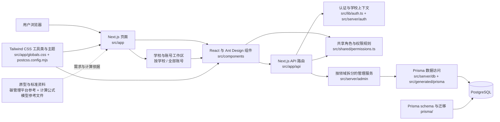

# 碳管理平台项目文件架构图

> 依据 2026-09-24 的工作区文件整理。主应用是 `Carbon-Management-Platform/`；`碳管理平台参考/` 是独立的前端原型，`计算公式模型参考文件/` 存放标准参考资料。下列文件树逐一说明工作区内的项目文件；`node_modules/`、`.next/` 等大量可再生文件仅说明目录用途。

## 1. 总体架构



说明：当前主应用已实现登录、学校与账号管理、学校切换、公共数据版本和审计。学校与账号工作区组合学校列表、学校成员管理和全部账号视图；删除账号时保留匿名历史记录，以维持审计与资料引用。碳足迹模型、核算、报告页面目前是功能介绍与占位入口，尚无对应的完整业务数据流。参考原型及 PDF 不是主应用运行依赖。

## 2. 文件树与逐文件用途

路径相对于工作区根目录 `碳管理平台/`。`page.tsx` 是页面入口，`layout.tsx` 是页面布局，`route.ts` 是 API 入口；括号目录 `(dashboard)` 是 Next.js 路由分组，不会出现在网址中。

```text
碳管理平台/
├── .DS_Store                                 macOS 自动生成的根目录元数据；与业务无关
├── .gitignore                                根目录 Git 忽略规则；排除密钥、依赖、构建缓存和系统文件
├── AGENTS.md                                 工作区文件变更时同步维护本文档的规则
├── 项目文件架构图.md                         本文档；项目目录、文件用途和调用关系
├── Carbon-Management-Platform/              当前 Next.js 主应用
│   ├── .env                                  本地真实环境变量；含数据库与认证配置，不应提交或公开内容
│   ├── .env.example                          本地开发环境变量示例
│   ├── .env.production.example               生产环境变量示例
│   ├── .env.test.example                     独立测试数据库的环境变量示例
│   ├── .gitignore                            Git 忽略规则，包括密钥、依赖、构建及自动生成文件
│   ├── .nvmrc                                指定 Node.js 24
│   ├── .prettierignore                       Prettier 格式化排除规则
│   ├── .DS_Store                             macOS 自动生成的目录元数据；与业务无关
│   ├── AGENTS.md                             本项目的界面组件与视觉风格开发约定
│   ├── README.md                             项目简介、启动步骤、现有能力与常用命令
│   ├── compose.yaml                          本地 PostgreSQL 容器、端口、数据卷及健康检查
│   ├── eslint.config.mjs                     ESLint 与 Next.js/TypeScript 检查配置
│   ├── next-env.d.ts                         Next.js 自动生成的 TypeScript 类型引用；由 Git 忽略
│   ├── next.config.ts                        Next.js 配置入口；当前无额外配置项
│   ├── package.json                          依赖、Node 版本要求和 npm 脚本
│   ├── package-lock.json                     npm 依赖版本锁文件，包含 Tailwind 构建依赖
│   ├── postcss.config.mjs                   Tailwind CSS 的 PostCSS 构建插件配置
│   ├── prisma.config.ts                      Prisma schema、迁移目录及数据库连接配置
│   ├── tsconfig.json                         TypeScript 编译配置与 @/* 路径别名
│   ├── tsconfig.tsbuildinfo                  TypeScript 增量检查缓存；可再生成
│   ├── .github/
│   │   └── workflows/
│   │       └── ci.yml                        GitHub Actions：安装、校验、测试、类型检查和构建
│   ├── docs/
│   │   ├── 碳管理平台从零到一开发流程.md          产品边界、技术方案、数据设计及分阶段计划
│   │   └── 阶段3业务决策与权限.md               账号、学校、校内角色及公共数据规则
│   ├── prisma/
│   │   ├── schema.prisma                     数据表、枚举、关联关系及 Prisma Client 生成设置
│   │   └── migrations/
│   │       ├── migration_lock.toml           Prisma 迁移使用的数据库类型锁定信息
│   │       ├── 20260923000000_init/
│   │       │   └── migration.sql             初始学校、用户、学校成员等基础表结构
│   │       ├── 20260923083907_stage3_identity_access/
│   │       │   └── migration.sql             阶段 3 的认证、平台角色、公共数据及审计表变更
│   │       └── 20260924000000_account_deletion/
│   │           └── migration.sql             增加账号删除时间，保留历史关联所需的匿名记录
│   ├── scripts/
│   │   ├── bootstrap-admin.ts                命令行初始化首个超级管理员账号与平台角色
│   │   └── stage3-smoke.mjs                  使用临时数据库验证阶段 3、归属移除与账号删除 API 流程
│   ├── tests/
│   │   ├── permissions.test.ts              校内角色权限矩阵单元测试
│   │   └── school-context.test.ts           学校上下文与跨校访问规则单元测试
│   ├── src/
│   │   ├── app/                              Next.js App Router 页面与 API
│   │   │   ├── globals.css                  Tailwind 主题、工具类入口及基础重置
│   │   │   ├── layout.tsx                   根布局、页面元数据、Ant Design 注册与主题 Provider
│   │   │   ├── page.tsx                     站点根路径；重定向到 /models
│   │   │   ├── error.tsx                    页面运行错误的重试界面
│   │   │   ├── not-found.tsx                404 页面
│   │   │   ├── login/
│   │   │   │   └── page.tsx                 登录表单及认证客户端交互，使用 Tailwind 工具类
│   │   │   ├── no-school/
│   │   │   │   └── page.tsx                 已登录但没有可用学校时的提示页
│   │   │   ├── (dashboard)/                 学校业务工作台路由分组
│   │   │   │   ├── layout.tsx               登录及学校归属校验，装配工作台外壳
│   │   │   │   ├── account/
│   │   │   │   │   └── page.tsx             学校工作台账号设置路由，加载共享组件
│   │   │   │   ├── models/
│   │   │   │   │   └── page.tsx             碳足迹模型模块占位页
│   │   │   │   ├── accounting/
│   │   │   │   │   └── page.tsx             碳足迹核算模块占位页
│   │   │   │   └── reports/
│   │   │   │       └── page.tsx             碳足迹报告模块占位页
│   │   │   ├── admin/                       平台系统管理页面
│   │   │   │   ├── layout.tsx               管理员身份校验，装配管理端外壳
│   │   │   │   ├── page.tsx                 /admin 重定向到学校管理
│   │   │   │   ├── account/
│   │   │   │   │   └── page.tsx             系统管理账号设置路由，加载共享组件
│   │   │   │   ├── schools/
│   │   │   │   │   └── page.tsx             查询学校与账号，装配统一管理工作区
│   │   │   │   ├── users/
│   │   │   │   │   └── page.tsx             旧账号地址重定向到全部账号视图
│   │   │   │   ├── public-data/
│   │   │   │   │   └── page.tsx             查询公共数据版本并装配管理界面
│   │   │   │   └── audit/
│   │   │   │       └── page.tsx             查询最近审计日志并展示
│   │   │   └── api/                         服务端 HTTP 接口
│   │   │       ├── health/
│   │   │       │   └── route.ts             GET /api/health；仅报告应用进程状态
│   │   │       ├── auth/
│   │   │       │   └── [...all]/
│   │   │       │       └── route.ts         Better Auth 通用认证接口；屏蔽其管理端点
│   │   │       ├── schools/
│   │   │       │   └── active/
│   │   │       │       └── route.ts         POST；校验成员身份并写入当前学校 Cookie
│   │   │       ├── public-data/
│   │   │       │   └── route.ts             GET；向学校用户返回已发布公共数据
│   │   │       └── admin/
│   │   │           ├── memberships/
│   │   │           │   └── route.ts         POST/DELETE；设置或移除账号的学校归属
│   │   │           ├── schools/
│   │   │           │   ├── route.ts         POST；创建学校
│   │   │           │   └── [id]/
│   │   │           │       └── route.ts     PATCH；改学校名称或启停状态
│   │   │           ├── users/
│   │   │           │   ├── route.ts         POST；创建学校账号
│   │   │           │   └── [id]/
│   │   │           │       ├── route.ts     PATCH/DELETE；改账号或删除非平台管理员账号
│   │   │           │       └── password/
│   │   │           │           └── route.ts  POST；重置账号密码
│   │   │           └── public-data/
│   │   │               ├── route.ts         POST；新建公共数据草稿
│   │   │               └── [id]/
│   │   │                   ├── route.ts     PATCH；编辑未发布草稿
│   │   │                   └── publish/
│   │   │                       └── route.ts  POST；发布公共数据版本
│   │   ├── components/                      复用的界面组件
│   │   │   ├── providers.tsx                Ant Design 中文语言、主题及消息组件上下文配置
│   │   │   ├── backend-shell.tsx            组合后台导航、顶栏、页签和主内容区
│   │   │   ├── backend/
│   │   │   │   ├── navigation.tsx           后台侧栏及移动端抽屉导航
│   │   │   │   ├── header.tsx               顶栏、面包屑及账号菜单
│   │   │   │   └── route-tabs.tsx           已访问页面的可关闭页签
│   │   │   ├── app-shell.tsx                学校工作台导航、学校切换及退出登录
│   │   │   ├── module-landing.tsx           尚未实现业务模块的统一占位内容
│   │   │   ├── sign-out-button.tsx          可复用退出登录按钮
│   │   │   ├── account/
│   │   │   │   └── account-settings.tsx    两个账号设置路由共用的修改密码组件
│   │   │   └── admin/
│   │   │       ├── admin-shell.tsx          系统管理导航、工作台切换及退出登录
│   │   │       ├── api.ts                   管理界面统一请求与错误处理函数
│   │   │       ├── audit-table.tsx         审计日志表格
│   │   │       ├── school-accounts-workspace.tsx  按学校与全部账号视图的路由和内容组合
│   │   │       ├── public-data-manager.tsx  公共数据页面状态与保存、发布操作
│   │   │       ├── public-data/
│   │   │       │   ├── types.ts             公共数据行、表单类型与类型名称
│   │   │       │   ├── public-data-table.tsx  公共数据版本列表与行操作
│   │   │       │   └── public-data-dialog.tsx  草稿新建与编辑弹窗
│   │   │       ├── schools-manager.tsx     学校页面状态与保存、启停操作
│   │   │       ├── schools/
│   │   │       │   ├── types.ts             学校列表与表单类型
│   │   │       │   ├── schools-filter.tsx   学校搜索与状态筛选
│   │   │       │   ├── schools-table.tsx    学校列表及行操作
│   │   │       │   └── school-dialog.tsx    学校新建与编辑弹窗
│   │   │       ├── users-manager.tsx       按学校或全局展示账号、筛选与操作界面
│   │   │       └── users/
│   │   │           ├── types.ts            账号、学校选项及表单类型
│   │   │           ├── users-filter.tsx    账号关键字、学校及状态筛选
│   │   │           ├── users-table.tsx     账号列表、角色标签和行操作
│   │   │           ├── users-dialogs.tsx   账号管理弹窗的切换与确认逻辑
│   │   │           ├── assign-existing-dialog.tsx  将已有账号分配到指定学校的表单弹窗
│   │   │           ├── use-users-actions.ts  账号和学校归属操作的客户端状态与请求流程
│   │   │           ├── create-account-form.tsx  新建账号表单
│   │   │           ├── edit-account-form.tsx  编辑账号表单
│   │   │           ├── school-membership-form.tsx  学校归属与角色表单
│   │   │           └── password-reset-form.tsx  重置密码表单
│   │   ├── lib/
│   │   │   ├── auth.ts                     Better Auth 服务端配置、数据库适配及认证规则
│   │   │   └── auth-client.ts              浏览器端 Better Auth 客户端
│   │   ├── shared/
│   │   │   └── permissions.ts              客户端与服务端共用的校内角色、动作及权限矩阵
│   │   ├── server/                          仅服务端使用的业务、权限和数据库模块
│   │   │   ├── admin/
│   │   │   │   ├── service.ts              管理服务的统一导出入口
│   │   │   │   ├── audit.ts                业务操作审计日志写入函数
│   │   │   │   ├── schools.ts              学校创建、修改与启停业务
│   │   │   │   ├── accounts.ts             账号创建、修改、启停、删除与密码重置业务
│   │   │   │   ├── memberships.ts          学校成员归属、角色和移除维护业务
│   │   │   │   └── public-data.ts          公共数据草稿、编辑与发布业务
│   │   │   ├── auth/
│   │   │   │   ├── access.ts               当前用户、平台管理员与学校上下文校验
│   │   │   │   └── school-context.ts       解析并校验指定学校的成员身份
│   │   │   ├── db/
│   │   │   │   ├── client.ts               对外统一导出数据库实例
│   │   │   │   └── prisma.ts               创建/复用 Prisma Client 与 PostgreSQL 适配器
│   │   │   └── http/
│   │   │       ├── json.ts                 读取并校验请求 JSON 格式
│   │   │       └── response.ts             请求异常类型与统一错误响应
│   │   └── generated/prisma/                `npm run db:generate` 生成；不应手工编辑
│   │       ├── browser.ts                   浏览器可用的 Prisma 类型入口
│   │       ├── client.ts                    服务端 Prisma Client 入口
│   │       ├── commonInputTypes.ts          查询、筛选、排序等通用输入类型
│   │       ├── enums.ts                     从 schema 生成的枚举定义
│   │       ├── models.ts                    各数据模型类型的统一导出
│   │       ├── internal/
│   │       │   ├── class.ts                 Prisma Client 内部类实现
│   │       │   ├── prismaNamespace.ts       服务端 Prisma 命名空间与内部类型
│   │       │   └── prismaNamespaceBrowser.ts  浏览器侧 Prisma 命名空间类型
│   │       └── models/
│   │           ├── Account.ts               认证账号模型类型与查询类型
│   │           ├── AuditLog.ts              审计日志模型类型与查询类型
│   │           ├── PlatformRole.ts          平台角色模型类型与查询类型
│   │           ├── PublicDataVersion.ts     公共数据版本模型类型与查询类型
│   │           ├── School.ts                学校模型类型与查询类型
│   │           ├── SchoolMembership.ts      学校成员关系模型类型与查询类型
│   │           ├── Session.ts               登录会话模型类型与查询类型
│   │           ├── User.ts                  用户模型类型与查询类型
│   │           └── Verification.ts          认证验证记录模型类型与查询类型
│   ├── node_modules/                       npm 安装的第三方依赖；自动生成
│   └── .next/                              Next.js 开发/构建缓存与产物；自动生成
├── 碳管理平台参考/                            独立的静态页面原型，不属于 Next.js 应用
│   ├── .DS_Store                           macOS 自动生成的目录元数据
│   ├── index.html                          原型页面结构与导航容器
│   ├── css/
│   │   └── style.css                       原型页面样式
│   ├── js/
│   │   └── app.js                          原型交互、模拟数据及前端计算逻辑
│   └── .trae/documents/
│       └── 计算模型选择与管理.md               原型中计算模型选择和管理的实施方案
└── 计算公式模型参考文件/                       业务标准参考资料，不是可执行代码
    ├── .DS_Store                           macOS 自动生成的目录元数据
    ├── GBT+47651-2026温室气体 产品碳足迹量化方法与要求 光热发电.pdf
    │                                       光热发电产品碳足迹量化标准参考
    ├── GBT+47652-2026温室气体 产品碳足迹量化方法与要求 光伏发电.pdf
    │                                       光伏发电产品碳足迹量化标准参考
    └── GBT+47661-2026温室气体 产品碳足迹量化方法与要求 风力发电.pdf
                                            风力发电产品碳足迹量化标准参考
```

## 3. 修改功能时通常从哪里开始

| 需求 | 主要位置 |
| --- | --- |
| 修改页面与导航 | `src/app/` 对应 `page.tsx`、`layout.tsx`，以及 `src/components/` |
| 新增或修改管理接口 | `src/app/api/admin/`，实际业务写入 `src/server/admin/` 对应领域模块 |
| 调整登录、学校选择和权限 | `src/lib/auth.ts`、`src/server/auth/`、`src/shared/permissions.ts`、`src/app/api/auth/` |
| 修改数据库结构 | `prisma/schema.prisma`，随后创建迁移并重新生成 `src/generated/prisma/` |
| 修改颜色或布局 | `src/components/providers.tsx` 的 Ant Design 令牌、`src/app/globals.css` 的 Tailwind 主题，以及对应组件的工具类 |
| 验证行为 | `tests/` 单元测试、`scripts/stage3-smoke.mjs` 集成测试 |

`src/generated/prisma/`、`node_modules/`、`.next/`、`tsconfig.tsbuildinfo` 和 `.DS_Store` 都属于自动产物或系统文件；开发时主要维护 schema、源码、测试和文档。

## 4. 架构图维护规则

每次新增、删除、重命名或移动项目文件，都要在**同一次修改**中更新上面的文件树，并说明新增文件的用途。若目录职责或模块调用关系发生变化，也要更新总体架构图和相关文字。交付前核对实际文件清单与文档一致；依赖和构建缓存目录按目录记录，不逐个列出其中的自动文件。

新增功能时将有独立职责的表单、表格、筛选区、导航和服务端业务流程拆成组件或模块，再由页面和入口文件组合。相关状态和回调仍由负责该流程的上层组件管理。
